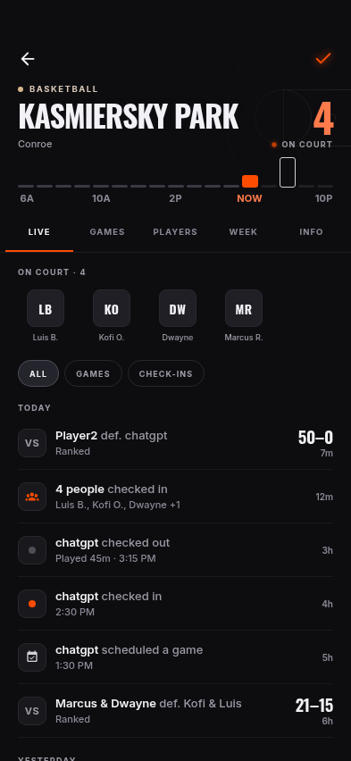
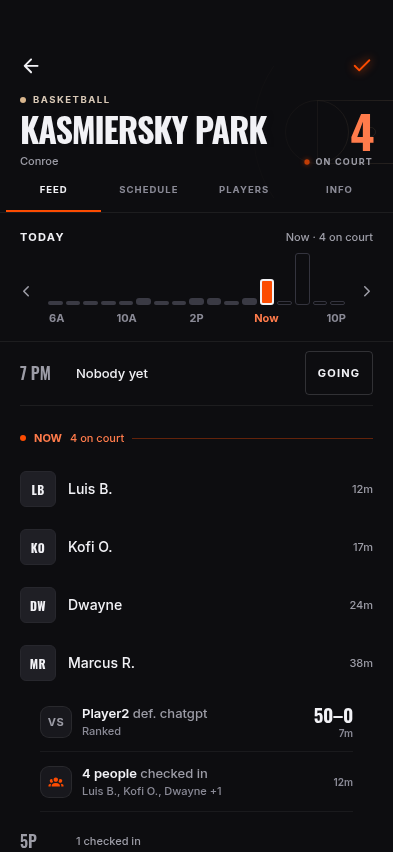
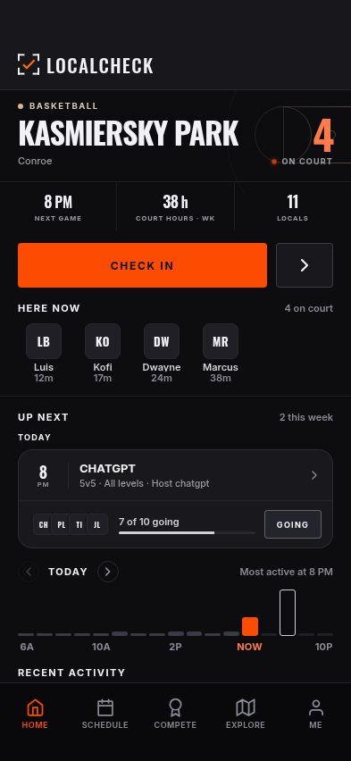
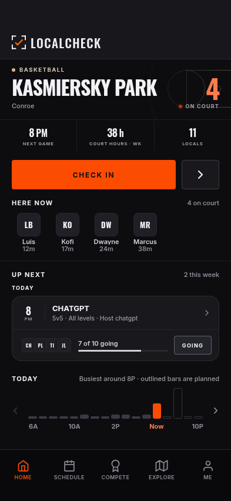
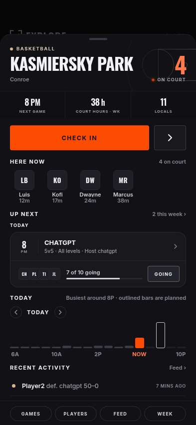
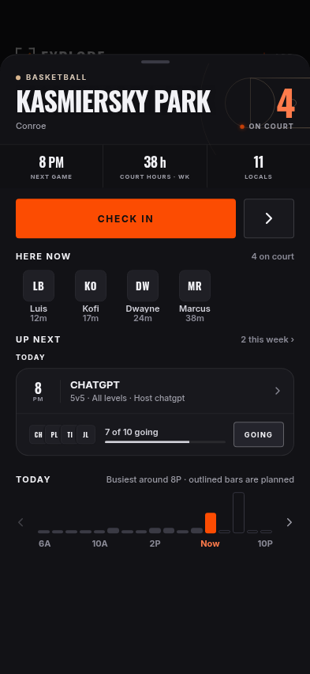
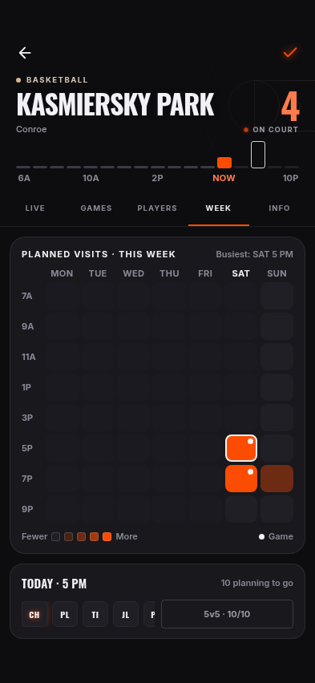
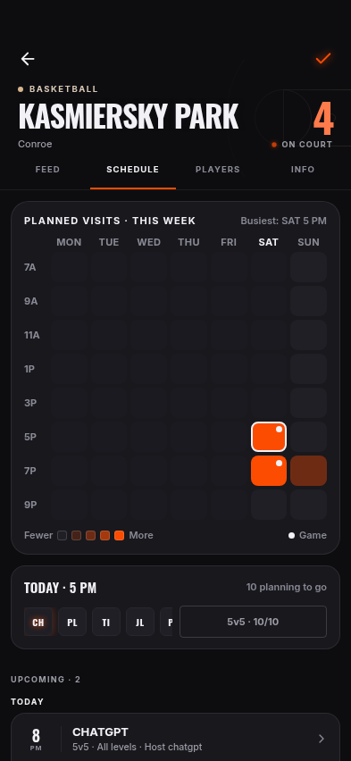

# Court activity feed / LCv5 comparison

On branch, for review. Current main: a606de3. Reference LCv5:
[41ebfde](https://github.com/jGPT-Automated/LCv5/tree/41ebfde7c142f2534e2a8968b37fcb545c6802fc).
[Color comparison and plan](../../../plans/2026-11-03-court-activity-feed.md).

All app captures are actual rendered Expo web screens with isolated fixture
responses, a fixed Saturday 6:30 PM Central clock and blocked WebSockets.
No live account/backend was accessed. The LCv5 board is copied unaltered from
that reference repo's `docs/chunks/01-screens/home.png`; it is a mock-data
prototype, not the implemented app or live data.

## PR #89 review correction

[Logic-only correction, paired screenshots and regression evidence](review-fix/README.md).
The original captures below remain unchanged. The correction preserves the
approved appearance and fixes hour selection, day-change measurement and
missing-actor navigation.

## What to inspect

- Court opens on Feed: fixed court identity/tabs and chart; one vertical hour
  timeline. Scrub/tap bars or scroll the timeline to select an hour. Day arrows
  sit beside the graph; swipe the day-label row to change days.
- Future hours list names and the existing Going action. Now uses shared square
  PlayerAvatar; private attendance is counted without inventing identities.
  Game links open the game; Going remains a planned visit, not a game RSVP.
- Home/drawer stay dashboards. CourtDayPlanner composes the same chart and
  compact hour row from one snapshot. Picking a time reveals that whole row
  above the 88pt Home floor or within the sheet.
- Schedule combines the existing heatmap/slot with upcoming game cards in one
  scroller. Heatmap selection opens the corresponding hour in Feed. Parent
  owns the common gutter: game cards measure 12pt left/right at all sizes.
- Existing CourtTitleRow, CourtArt, PlayerAvatar and global palette are retained.
  No Settings, subscription, native dependency or backend/schema change.

## Before / after (393 × 852)

Same court, clock and viewport. Scrolling differs where content was removed or
where the selected time is intentionally revealed. New states are standalone.

| Surface | Before: current main | After: activity branch |
| --- | --- | --- |
| Court opening |  |  |
| Home |  |  |
| Expanded drawer |  |  |
| Court Schedule |  |  |

All images also have 375 and 430 variants. `after/` includes scrubbed hour,
Going, failed save, failed load, heatmap pick, empty court, private presence,
Home/drawer selected time and the scrolled Schedule game cards. Court Players
and Info captures confirm the shared four-tab header on sibling screens.

## Verification and limits

[Feed journey](feed-journey.json): chart tap/drag, list scroll synchronization,
anchored chart, day arrows/day-label swipe, private/empty states, failed save,
retry, confirmed add/reload/removal, heatmap handoff and load retry. Three sizes,
zero page errors. Chart y stayed **253 → 253** during vertical scrolling at
375, 393 and 430 widths.

[Planner recheck](planner-journey.json): after the shared planner change, only
Home/drawer were rechecked at the three sizes. Assertions verify the selected
hour clears the **88pt** tab floor and retains anonymous planning. Zero page
errors and zero hard drawer clipping/overlap findings.

[Schedule measurements](schedule-gutters.jsonl): **12pt / 12pt** left/right
at each width, after removing the nested game-list gutter.

[Main audit](main-audit.md), [branch audit](activity-audit.md),
[comparison](audit-comparison.md): zero hard clipping, overlap or sideways page
scroll failures. Accessibility baseline is already exceeded by current main;
small inherited text and touch targets remain, particularly in the reused
heatmap/game cards. No limits were raised. This is not a clean accessibility
sign-off. Native iOS gesture arbitration and Dynamic Type were not exercised;
production realtime/RLS was not contacted. No phone-build claim is made.

`pnpm check`: 270 tests, types, component ownership and docs checks. Interactive
proof uses `scripts/visual-qa/court-activity-journey.mjs`; `QA_PLANNER_ONLY=1`
scopes a planner-only follow-up. No production release or database operation.

## File trail

- [Court route](../../../../app/court/[id].tsx),
  [CourtActivityFeed](../../../../components/court/CourtActivityFeed.tsx),
  [CourtDayPlanner](../../../../components/court/CourtDayPlanner.tsx),
  [CourtBusyChart](../../../../components/court/CourtBusyChart.tsx),
  [HourSlotCard](../../../../components/court/HourSlotCard.tsx),
  [SlotCard](../../../../components/court/SlotCard.tsx).
- [Home](../../../../components/HomeScreen.tsx),
  [drawer](../../../../components/sheet/CourtSheetContent.tsx),
  [court heatmap](../../../../components/CourtSchedulePanel.tsx),
  [game list](../../../../components/court/CourtGamesPanel.tsx).
- [Snapshot hook](../../../../hooks/useCourtActivity.ts),
  [hour model](../../../../lib/courtActivityModel.ts),
  [model tests](../../../../lib/courtActivityModel.test.mts),
  [court service](../../../../services/courtService.ts),
  [plan service](../../../../services/plannedVisitService.ts).
- [Activity row](../../../../components/ui/ActivityRow.tsx),
  [review regressions](../../../../scripts/visual-qa/pr89-review-journey.mjs),
  [journey](../../../../scripts/visual-qa/court-activity-journey.mjs),
  [screen cases](../../../../scripts/visual-qa/screens.mjs),
  [isolated runner](../../../../scripts/visual-qa/run.mjs),
  [component ownership rules](../../../../scripts/check-design-consistency.mjs),
  [test script](../../../../package.json).
- [Current state](../../../CURRENT_STATE.md),
  [feedback](../../../FEEDBACK_TRACKER.md),
  [testing](../../../TESTING.md), [decisions](../../DECISIONS.md),
  [design](../../DESIGN.md), [product](../../PRODUCT.md),
  [plan](../../../plans/2026-11-03-court-activity-feed.md),
  [repo index](../../../../README.md).
