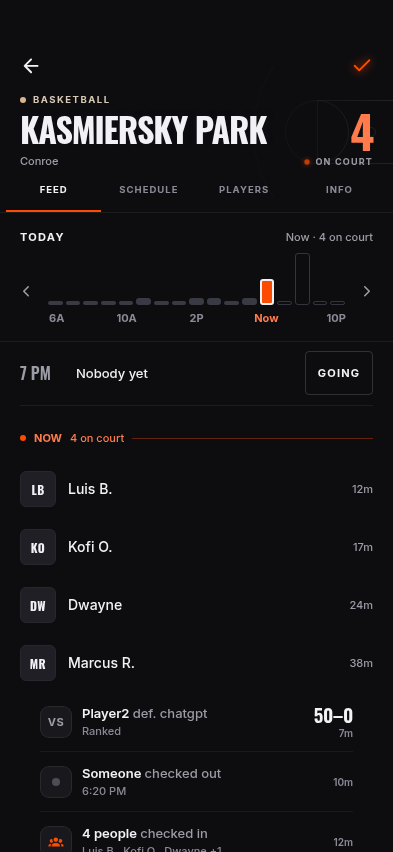
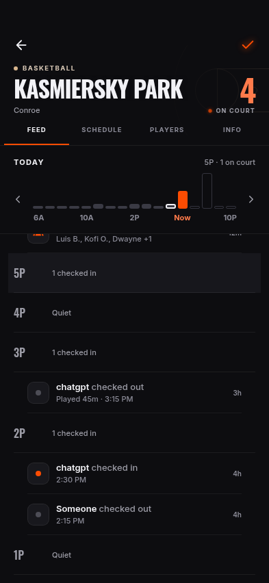
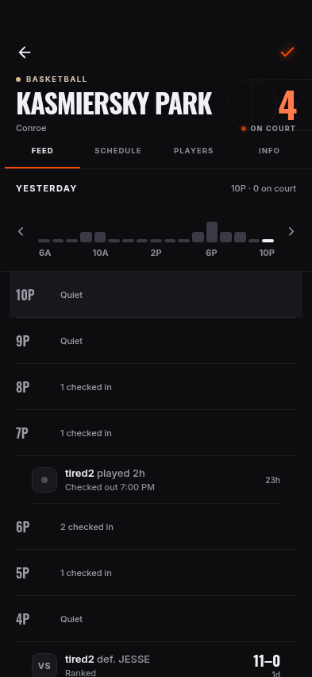
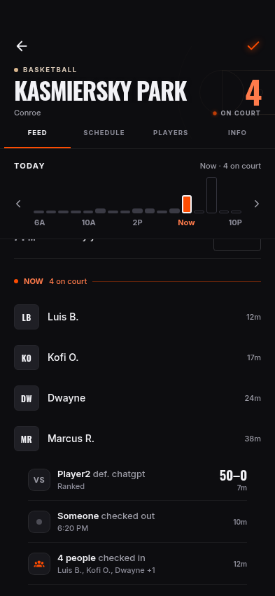
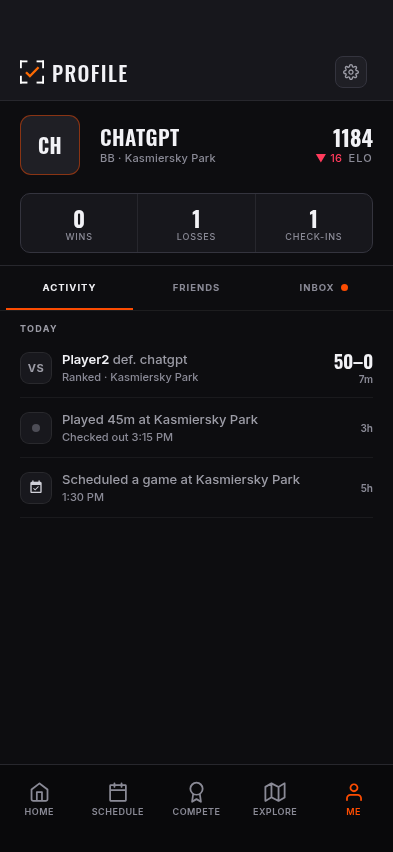
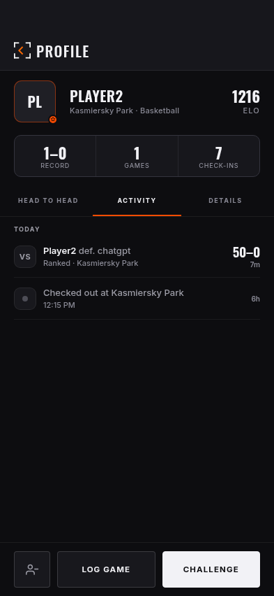

# PR #89 logic-review correction

**On branch**, November 3. Jesse selected logic fixes only before the
checkpoint merge. Before captures use PR head `dcad46b`; after captures use
the corrected branch. The original activity-feed evidence remains intact.

## Changes and paired captures

Same isolated fixtures, court, clock (Saturday 6:30 PM Central) and viewport.
The changed scroll positions reflect the corrected selected hour.

| Interaction | Before (393 × 852) | After (393 × 852) |
| --- | --- | --- |
| Tap today's 5 PM heatmap block |  |  |
| Select yesterday's top 10 PM row |  |  |
| Missing actor in Now |  |  |
| Me's default date heading |  |  |
| Player's default date heading |  |  |

Every capture also has 375 × 667 and 430 × 932 variants. Me/player before
and after PNGs are byte-identical at every size. Both actorless
Now/past states are captured; their navigation result is an assertion in the
journey, not something a still image proves.

## Implementation

- Heatmap navigation passes the actual block start hour. The current two-hour
  block stays selectable and completed blocks stay disabled.
- Programmatic scrolling and scroll tracking share a 28pt focus, within the
  shortest 58pt row. Day changes reset measured rows; queued layout callbacks
  use only the latest pending selection. The rapid-scrub test exposed stale
  position-only measurements after a web day change, then a queued older
  focus overriding a newer tap. Both are included in the same correction.
- Both event groups pass the real previous event and guard absent player IDs.
  Shared ActivityRow gains `showDayHeader?: boolean`, default true. Only the
  hourly court feed disables it because the chart already owns its day label.

No avatar/card/control/palette redesign, new dependency, backend contract or
schema change. No Supabase access, live account, native build, merge or release.

## Evidence and limits

[Before 393](before-results-393.json), [before 375/430](before-results-other.json)
record the reproduced hour-selection and actor-navigation failures.
[Final regression journey](review-results.json) covers all three sizes:
current/future heatmap picks, top historical hour, repeated scrubbing across
past/today/future days, manual scrolling with the chart anchored at y=253,
actorless Now/past taps, valid player navigation, one court date heading and
unchanged Me/player headings. Zero page errors or product writes. Each final
capture also checks hard clipping, overlap and sideways page scroll.

[Existing save/retry journey](save-retry-results.json) rechecks failed save,
retry, confirmed add/reload/removal, load recovery, private/empty states and
Home/drawer selected-hour clearance at all three sizes. Its writes are to
in-memory fixtures only. All backend HTTP is fulfilled locally and every
WebSocket is blocked before navigation.

[Scoped layout audit](layout-audit.md): zero hard failures. Six inherited
above-baseline text/target entries remain in reused heatmap/Schedule states;
no baseline was changed. This correction does not resolve the original PR's
accessibility findings. Browser evidence does not claim native-device,
Dynamic Type, production realtime or RLS verification.

The project checks cover 270 existing tests, types, ownership and docs. The
three-file logic patch also received an independent review; the subsequent
day-change correction was verified by its reproduced browser regression.

## Changed-file trail

- [Heatmap](../../../../../components/CourtSchedulePanel.tsx),
  [court timeline](../../../../../components/court/CourtActivityFeed.tsx),
  [shared activity row](../../../../../components/ui/ActivityRow.tsx).
- [Regression journey](../../../../../scripts/visual-qa/pr89-review-journey.mjs),
  [testing instructions](../../../../TESTING.md),
  [approved plan](../../../../plans/2026-11-03-court-activity-feed.md).
- [Current state](../../../../CURRENT_STATE.md),
  [feedback](../../../../FEEDBACK_TRACKER.md),
  [decisions](../../../DECISIONS.md), [design](../../../DESIGN.md),
  [product](../../../PRODUCT.md), [parent evidence index](../README.md).
