# Dashboard design follow-up

**On branch**, [PR #90](https://github.com/jGPT-Automated/LocalCheck_Expo/pull/90), based on merged main `19dac69` (PR #89). This checkpoint
implements the selected-hour dashboard/card visuals deferred from that PR.
The multi-court and rolling-lobby work is still a review draft.

## Paired renders

Actual Expo web screens, isolated fixtures, Saturday 6:30 PM Central. Each
pair uses the same route, court, selected hour, data and viewport. Scroll
position can differ because the selected card is intentionally revealed.
Before source: `19dac69`. Dashboard/day/rapid after source: `a7d7a6c`.
RSVP, Schedule and drawer-stability captures were taken at `ef8f566`; the
subsequent changes are the shared chart callback and sheet navigation owners.
[Export provenance](export-provenance.json) records the capture build's older
Git label and the fresh `a7d7a6c` export. Every application function and all
CSS/fonts/images match; only generated CSS-module export key order differed.
The [committed-preview smoke](committed-preview-results.json) repeats all ten
checks at 393×852 with metadata confirming `a7d7a6c`; the primary 393 captures
above use that export.

| Route / state, 393 × 852 | Before | After |
| --- | --- | --- |
| Home, selected 8 PM scheduled hour | 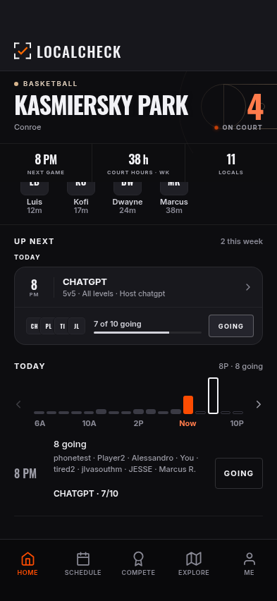 | 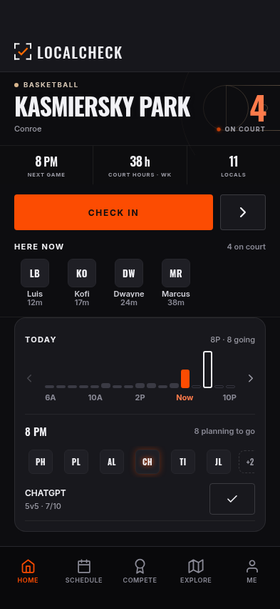 |
| Home, 7 PM intent | 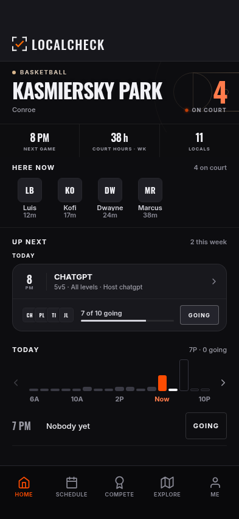 | 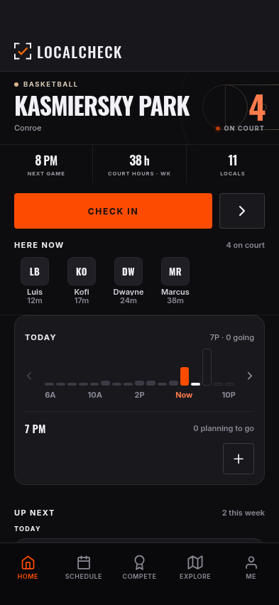 |
| Expanded Explore drawer, tomorrow 8 PM private attendance | 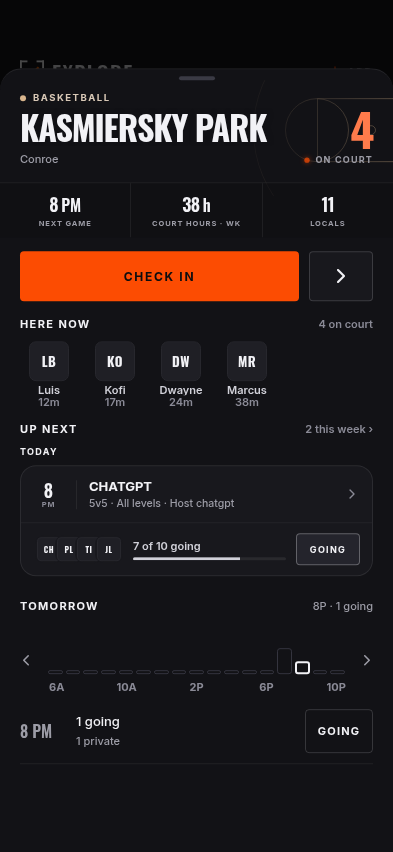 | 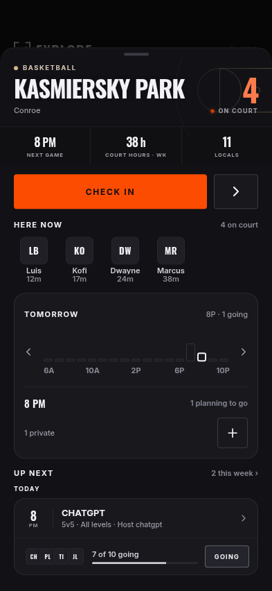 |
| Schedule, selected future slot | 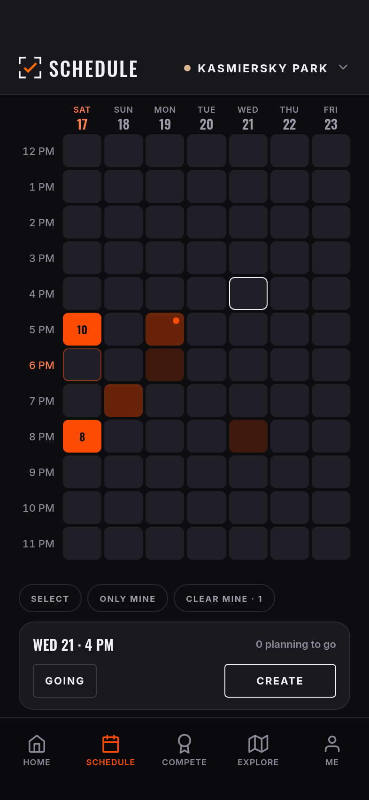 | 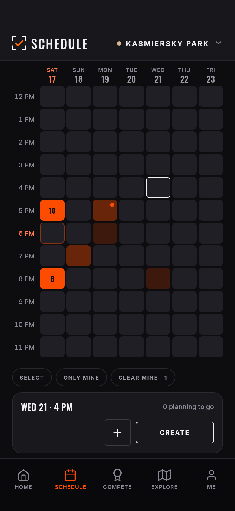 |
| Drawer, immediate switch to Tomorrow then 8 PM | 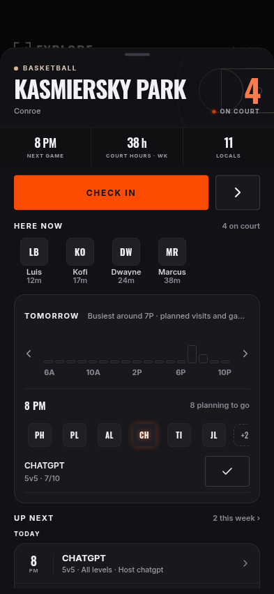 |  |
| Court Feed, 8 PM attendees and game | 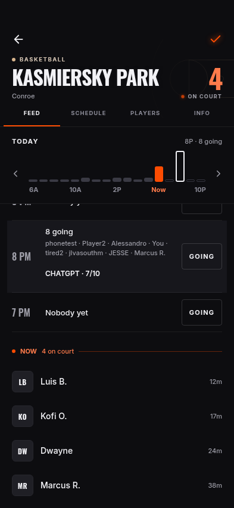 | 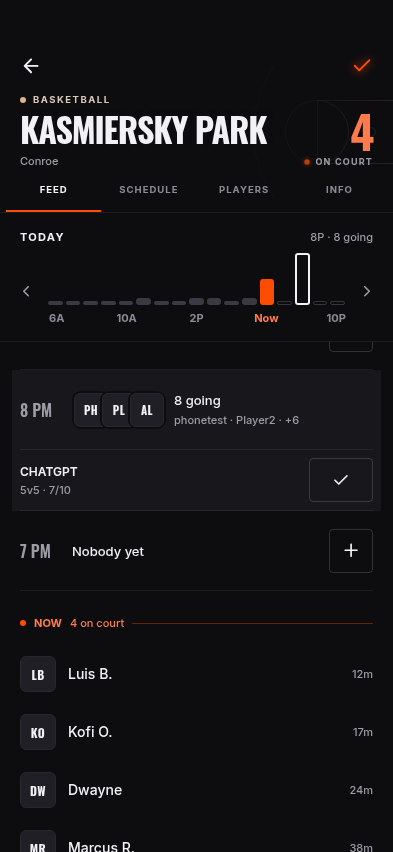 |

The retained folders include 375 × 667 and 430 × 932 counterparts. Game RSVP
proof covers failure/retry, full capacity, joined state, team-selection
navigation, multiple games in one hour and a 24-character name.

## What changed

- Home and drawer share CourtDayPlanner's charcoal panel, square attendees
  and 44pt plus/check planned-visit control. Next game follows the planner.
  Selecting an hour reveals its card above the tab/sheet floor.
- A selected scheduled hour identifies every game with its existing RSVP;
  Up next can be a different game. A game hour does not offer a redundant
  add-intent action; an existing personal visit retains its removal control.
- Court future rows use SlotCard's compact square stack and readable names,
  plus the same ScheduledGameCard RSVP state machine. Planned intent, current
  presence and durable game membership remain distinct. Private attendance
  has no invented identity and its count is included in the spoken summary.
- The drawer removes a queued post-opening snap that was traced closing it
  without input. Its measured snap points and pan-down close remain. Selected
  profile/game links use its existing dismiss-then-navigate owner.
- Shared chart gestures read the latest committed state: an immediate day
  switch followed by a bar tap cannot restore the previous day's attendance.
- Headers, court art, palette, check-in and saved/default-court behavior
  retain their existing shared implementations.
- The PR template and visual-history index now make these pairs standard for
  frontend work. Previous captures are retained as earlier versions.

## Interactive verification

- [Dashboard journey](dashboard-results.json): **30/30**, ten checks at each
  phone size. Includes selected-slot floor clearance, error/retry/remove,
  private-only spoken count and sheet dismissal before run/profile navigation.
- [RSVP journey](rsvp-results.json): **15/15**, failure followed by one confirmed
  retry, full game, team-choice navigation without premature join, multiple
  games and a 24-character attendee name. Only in-memory fixtures were written.
- [Day-selection regression](day-results.json): eight Today/Tomorrow cycles at
  each size, checking both chart and selected attendance/game. Before the fix,
  instrumentation traced a Today callback after Tomorrow was rendered; the
  retained wrong-day screenshot is an unmodified app render.
- [Linked chart journey](rapid-results.json): rapid tap/drag and manual scroll
  stay synchronized on past/today/future days at all three sizes.
- [Drawer stability](drawer-stability-results.json): **15/15** no-input opens,
  zero y drift in collapsed/expanded samples; explicit expansion, court
  navigation and backdrop dismissal work. Before the fix a redundant resnap
  was traced immediately before index 0 → -1/dismiss without a backdrop press.
  Pan-down gesture and later measured-height changes were not exercised here.

[Before scoped audit](before-audit.md), [after scoped audit](after-audit.md):
seven affected states × three sizes, zero hard clipping/overlap/sideways-scroll
failures on both. Both have 16 above-baseline entries inherited from the reused
text/targets; some counts fall after the slot changes. No baseline was raised.
[Schedule comparison](schedule-comparison.md) has additional matched captures for its opening and two selected-slot
states; those three states have zero hard findings, small-text/contrast counts
unchanged, and small-target counts unchanged or one lower. The legacy case
name `schedule-mine` captures an empty future slot, not a confirmed personal
visit. The baseline runner also attempted an unrelated obsolete Schedule action
selector; its reachability failure is excluded from this matched set.

A separate early cold-load chart selection mismatch was not reproduced in a
held-response test or twelve immediate cold navigations. No speculative row
layout change was made and no fix is claimed for that isolated observation.
The final RSVP and rapid journeys above completed on their first integrated run.

## Backend boundary and remaining work

Live Supabase access was **read-only metadata inspection** of LocalCheckProd:
relation/column, function, constraint, trigger and policy definitions. No
player rows, write RPCs, schema changes, migrations or deployments were run.
All browser/backend traffic is fulfilled in memory or aborted; WebSockets
are blocked before navigation. The journeys' successful writes are fixture
updates only. No native build, production release or merge was performed.

[Multi-court/backend review draft](../../../plans/2026-11-03-multicourt-backend-review.md)
records the existing one-court profile/auto-check-in contract and the additive
proposal. The five-court LocalPlus list, default/reorder, Home/Schedule dropdown,
Explore saved section and nested per-court auto toggles are not implemented by
this checkpoint. The requested 10/4-slot presentation for actual scheduled
games is a subsequent frontend slice using existing capacity/participant data.
An hourly open-run lobby/queue and game-end progression need their separate
backend contract; planned visits are not a substitute. The drawer still uses
its existing inner detail scroller; the one-root-scroller refactor is a
remaining frontend task, not claimed by the resnap-close correction.

The inherited accessibility debt remains separate from this visual acceptance;
no baseline is raised. Browser evidence does not claim native-device,
production realtime or RLS write verification.

## Changed-file trail

- [Home composition](../../../../components/HomeScreen.tsx),
  [drawer composition](../../../../components/sheet/CourtSheetContent.tsx),
  [drawer host](../../../../components/sheet/CourtSheetHost.tsx),
  [shared planner](../../../../components/court/CourtDayPlanner.tsx),
  [shared chart](../../../../components/court/CourtBusyChart.tsx).
- [Slot card](../../../../components/court/SlotCard.tsx),
  [hour action owner](../../../../components/court/HourSlotCard.tsx),
  [scheduled game card](../../../../components/court/CourtGamesPanel.tsx).
- [Dashboard journey](../../../../scripts/visual-qa/dashboard-design-journey.mjs),
  [RSVP journey](../../../../scripts/visual-qa/dashboard-rsvp-journey.mjs),
  [drawer stability](../../../../scripts/visual-qa/court-drawer-stability-journey.mjs),
  [day-selection regression](../../../../scripts/visual-qa/court-day-selection-journey.mjs).
- [PR template](../../../../.github/pull_request_template.md),
  [contributor contract](../../../../AGENTS.md),
  [GitHub workflow](../../../GITHUB.md), [testing](../../../TESTING.md),
  [visual history](../README.md).
- [Current state](../../../CURRENT_STATE.md),
  [feedback](../../../FEEDBACK_TRACKER.md),
  [Supabase inspection](../../../SUPABASE.md),
  [decisions](../../DECISIONS.md), [design](../../DESIGN.md),
  [product](../../PRODUCT.md), [repo index](../../../../README.md),
  [implementation plan](../../../plans/2026-11-03-dashboard-design-followup.md).
