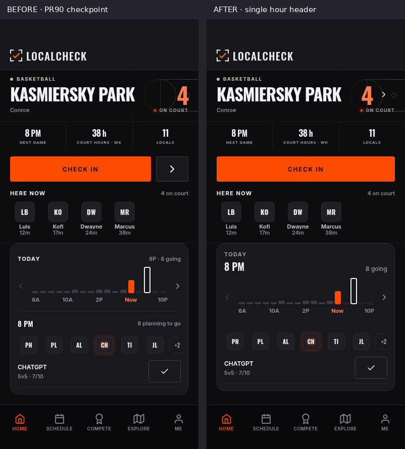
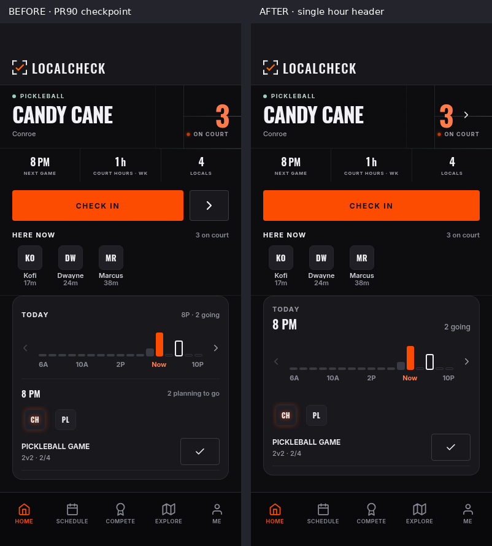
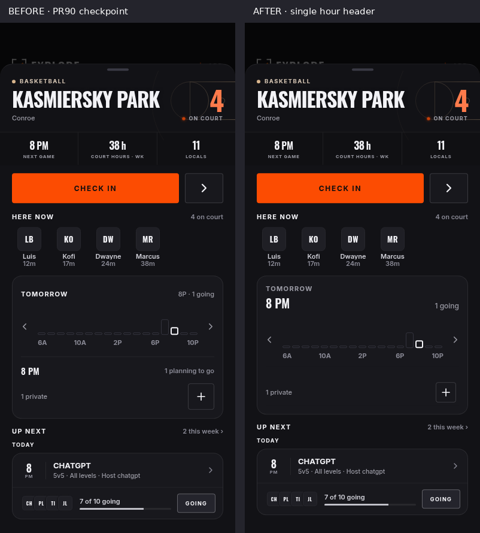
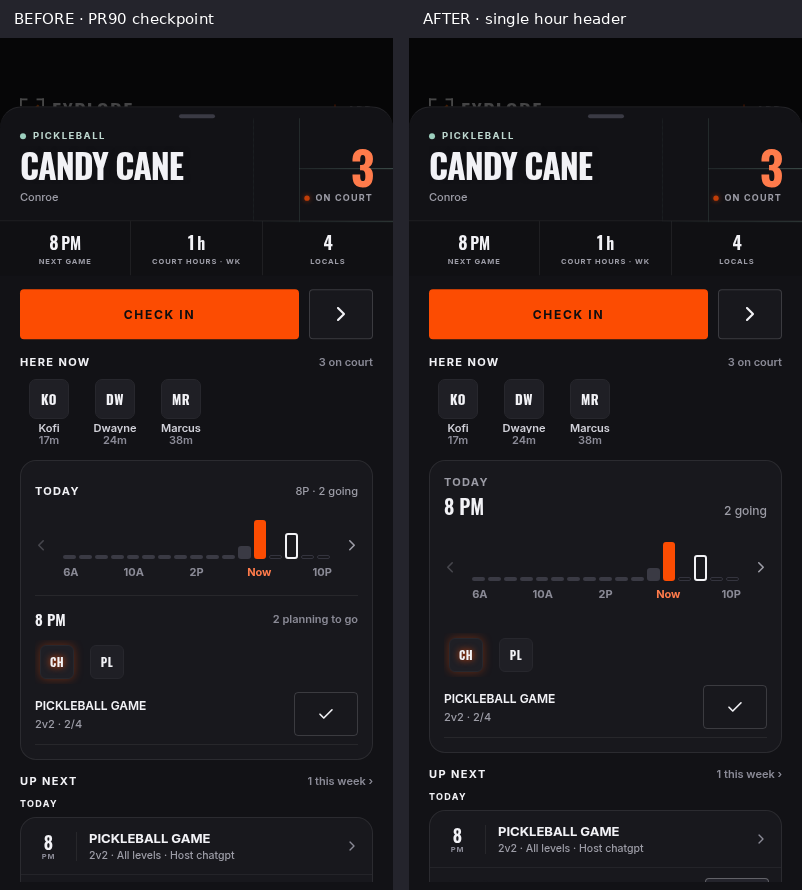

# PR #90 refinement: one selected-hour header

**On branch, not merged or released.** [PR #90](https://github.com/jGPT-Automated/LocalCheck_Expo/pull/90).
This is a small follow-up to the [November 3 checkpoint](../2026-11-03-dashboard-design/README.md), not the hourly-lobby implementation.

Baseline application/capture: `96f0c7f`. Final capture: `50746f2` (application
change `5a3f994`, followed only by journey assertions). Both previews came from
`pnpm preview:web`; their generated metadata is retained under `reports/`.
The rendered app, fixture data, clock, timezone and viewport match in each
before/after pair. Scroll positions change where selection is revealed.

## What changed

- Home and the expanded Explore drawer share one selected-hour header: day
  11pt, time 20pt, attendance 12pt. The repeated lower hour/count and inner
  chart/attendance divider are removed through CourtDayPlanner/SlotCard.
- The visible attendance plus/check is 34×34, matching the avatar. Both it and
  each avatar retain 44×44 actual targets. Busy, confirmed and failure states
  still use the existing planned-visit service.
- Home's existing Court link sits to the right of its live number, within the
  number row. The big arrow beside Check in is removed. The full court name
  remains visible at 375px; the art and shared palette are retained.
- Candy Cane provides a pickleball comparison: three fixture check-ins and a
  real scheduled-game shape with two of four participants. Basketball has
  four fixture check-ins and seven of ten game participants. This does **not**
  imply empty-spot lobbies or new queue storage exist.

| Basketball Home | Candy Cane Home |
| --- | --- |
|  |  |

| Basketball drawer | Candy Cane drawer |
| --- | --- |
|  |  |

## Captured routes and states

Every route below has 375×667, 393×852 and 430×932 PNGs in [before](before/)
and [after](after/), separated by sport. Initial Home and selected Home are
separate captures so navigation and the planner can both be reviewed.

| Surface | Route / state | Screenshot prefix |
| --- | --- | --- |
| Basketball Home | `/`, original local court, initial and selected 8 PM | `home-header`, `home-selected` |
| Basketball intent | `/`, empty 7 PM, save failure, retry, confirmed intent | `home-intent`, `home-save-error`, `home-planned` |
| Basketball drawer | `/explore`, Kasmiersky Park, expanded, Tomorrow 8 PM private intent | `drawer-selected` |
| Basketball Court | `/court/abe05196-a2d2-469e-b919-0435a056d9a3`, Feed 8 PM | `court-future` |
| Pickleball Home | `/`, fixture-local Candy Cane, initial and selected 8 PM | `home-header`, `pickleball-home-selected` |
| Pickleball drawer | `/explore`, Candy Cane, expanded, Today 8 PM | `pickleball-drawer-selected` |
| Pickleball Court | `/court/dddddddd-dddd-4ddd-8ddd-dddddddddddd`, Feed 8 PM | `pickleball-court-selected` |
| Schedule | `/schedule`, selected heatmap states, shared SlotCard | `schedule-slot`, `schedule-mine` |

The legacy `schedule-mine` scenario selects an empty future hour; its name is
not proof of an owned planned visit. Confirmed/removal behavior is exercised
by the Home attendance journey instead.

## Reproduction and evidence

Start a preview from the desired source commit, then run:

```bash
TMPDIR=/tmp PORT=8112 corepack pnpm@10.13.1 preview:web
node scripts/visual-qa/dashboard-design-journey.mjs http://127.0.0.1:8112 /tmp/basketball
DASHBOARD_SPORT=pickleball node scripts/visual-qa/dashboard-design-journey.mjs http://127.0.0.1:8112 /tmp/pickleball
DASHBOARD_SIZES=393x852 node scripts/visual-qa/court-day-selection-journey.mjs http://127.0.0.1:8112 /tmp/day
CHROMIUM_PATH=/usr/bin/chromium QA_ONLY=home-feed,home-scrolled,explore-drawer,court-feed-tomorrow,court-week,schedule-slot,schedule-mine corepack pnpm@10.13.1 qa:visual <preview-export-directory> --out /tmp/audit
```

- [Basketball journey](reports/final-basketball.json): 36 assertions across
  three sizes. Includes one time/count header, display hierarchy, full Home
  court name, arrow placement/navigation, actual 44pt target/34pt visual,
  selected-card clearance, save failure/retry/removal, game identity/RSVP,
  private counts and drawer-dismiss-before-player/game-navigation.
- [Pickleball journey](reports/final-pickleball.json): 18 assertions across
  three sizes for Home, drawer and Court, including 2/4 capacity and the same
  header/navigation contract.
- [Day regression](reports/final-day.json): eight rapid Today/Tomorrow cycles
  at 393×852 retain the displayed day and its attendance. The shared gesture
  snapshot fix and default Feed chart presentation remain unchanged.
- Review caught a clipped Home court name in the first arrow layout at
  `1c2773a` ([captured failure](review/home-name-cutoff-1c2773a-375.png)).
  `5a3f994` puts the arrow in the number row; final checks explicitly require
  the full name and the arrow following the number.
- The scoped visual audit covers nine states at all three sizes. Raw
  [before](reports/before-audit.md) and [after](reports/after-audit.md) reports
  and the [comparison](reports/audit-comparison.json) retain the exact result.
  No hard layout failures or increases against the captured checkpoint were
  found in those 27 states. The raw runner still exits nonzero for inherited
  debt against its older repository baseline (small text fell 360→350,
  small targets stayed 682, low contrast stayed zero).
  Existing small text/target debt is not a full accessibility sign-off; the
  repository baseline is not raised to conceal it.
- `pnpm check` completed; the final title-row change was additionally
  typechecked. No dependency, native configuration or backend code changed.

**Isolation:** no live account login. Before navigation, remote backend HTTP
is fulfilled by an in-memory Supabase stand-in and all WebSockets are blocked.
The simulated write/error/retry interactions never reach Supabase. Other
remote requests are aborted except a fixed QR-parser script. These are actual
cloud Chromium renders of the Expo app, not design mockups. They prove browser
layout and the exercised frontend behavior, not native geofencing, production
RLS, push delivery or new lobby transitions.

## What remains separate

The hourly recurring casual lobby, empty joinable spots, game start/end,
odd-player behavior and optional ranked consent require the
[backend review contract](../../../plans/2026-11-03-multicourt-backend-review.md).
The existing plus means planned attendance, not joining that future lobby.
Actual scheduled-game 10/4-slot presentation, saved-court selectors and the
one-root drawer scroller are still subsequent slices, not delivered here.
No database change, write probe, migration, deployment, native build, release
or merge was performed.

## File trail

| File | Ownership/change |
| --- | --- |
| [components/court/CourtDayPlanner.tsx](../../../../components/court/CourtDayPlanner.tsx) | Composes the shared dashboard heading |
| [components/court/CourtBusyChart.tsx](../../../../components/court/CourtBusyChart.tsx) | Opt-in selected-hour header; default Feed unchanged |
| [components/court/SlotCard.tsx](../../../../components/court/SlotCard.tsx) | Embedded heading/rule removal; canonical attendance target/surface |
| [components/court/CourtParts.tsx](../../../../components/court/CourtParts.tsx) | Optional existing Court link in live number row |
| [components/ui/HomeCourtHero.tsx](../../../../components/ui/HomeCourtHero.tsx) | Owns Home navigation beside live; check-in-only action row |
| [components/HomeScreen.tsx](../../../../components/HomeScreen.tsx) | Wires the existing court route to the hero |
| [scripts/visual-qa/dashboard-design-journey.mjs](../../../../scripts/visual-qa/dashboard-design-journey.mjs) | Shared sport fixtures, header/action/navigation assertions |
| [docs/CURRENT_STATE.md](../../../CURRENT_STATE.md) | Branch status, no backend execution |
| [docs/FEEDBACK_TRACKER.md](../../../FEEDBACK_TRACKER.md) | Latest feedback tied to source and evidence |
| [docs/product/DESIGN.md](../../DESIGN.md) | One header and canonical visual/target rules |
| [docs/product/DECISIONS.md](../../DECISIONS.md) | D67 refinement and lobby boundary |
| [docs/product/PRODUCT.md](../../PRODUCT.md) | Present UI semantics |
| [docs/plans/2026-11-03-dashboard-design-followup.md](../../../plans/2026-11-03-dashboard-design-followup.md) | Delivered slice vs deferred work |
| [docs/plans/2026-11-03-multicourt-backend-review.md](../../../plans/2026-11-03-multicourt-backend-review.md) | Hourly casual lobby direction/open policies; proposal only |
| [docs/product/design-qa/README.md](../README.md) | Chronological visual-history entry |
| This folder | Retained raw renders, pairs and reproducible results |
