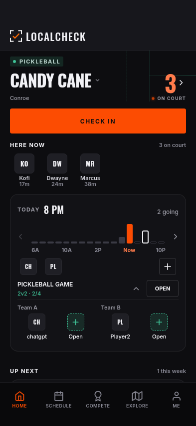

# Small checkpoint: pickleball Home hour card

**November 5 — card inspection only. No application changes in this turn.**
Source application `827c64df1dec00769707152fbc9f33bbfb164a35`. The broader
prior UI implementation remains separate from this documentation/QA checkpoint;
this does not merge or update PR #90.

Two existing helpers reviewed this single component. One captured/measured;
the other checked its geometry independently. The same fixture shows two
actual scheduled-game members and two vacancies. No backend writes were made.



## Measured alignment

| Check | Result |
| --- | --- |
| Viewports | 375×667, 393×852, 430×932; closed and expanded |
| Outer horizontal gutters | 20px on both sides at every width |
| Card widths | 335 / 353 / 390px |
| Inner content inset | 15px including the card border, symmetric |
| Closed / expanded card height | 227 / 315px at every width |
| Attendee and open-position visuals | 34×34px inside 44×44px targets |
| Game action | 64×34px visual inside 64×44px target |
| Expanded four-position row | All centers share the same y coordinate |
| Spacing within either team | Equal; the additional 12px between teams is deliberate grouping |
| Pickleball open outline / wash | `#3FC397` / `rgba(63,195,151,0.14)` |
| Card panel | `#121216` |
| Hard clipping/overlap/side-scroll findings | None in the inspected card |

At 375px the first expanded capture had part of the card border under the tab
bar. Checking the actual 88px tab-bar floor and remaining Home scroll range
showed this was capture framing, not a permanent sizing defect. A normal
15px additional scroll puts the full card bottom at y571, eight pixels above
the y579 floor. No padding/layout patch was made. The stored capture and
`scrollOwner` measurements reflect that correction.

These measurements establish internal alignment and palette use. They do not
establish a pixel-perfect copy of an entire user mock. The available saved
Claude artifact shows a different basketball Home state; numerical comparison
against a previous app capture is regression evidence, not mock fidelity.
The supplied pickleball board/text direction informs the square positions,
neutral surfaces, green court identity and restrained action treatment.

## Evidence and reproduction

- [Measurements, isolation counts and exact bounds](measurements.json).
- [375 closed](closed-375.png) / [375 expanded](expanded-375.png).
- [393 closed](closed-393.png) / [393 expanded](expanded-393.png).
- [430 closed](closed-430.png) / [430 expanded](expanded-430.png).
- [Home-only capture script](../../../../scripts/visual-qa/pickle-home-card-journey.mjs).

```bash
TMPDIR=/tmp PORT=8117 corepack pnpm@10.13.1 preview:web
QA_APP_SOURCE=827c64df1dec00769707152fbc9f33bbfb164a35 \
PICKLE_HOME_OUT=/tmp/pickle-home-card \
node scripts/visual-qa/pickle-home-card-journey.mjs http://127.0.0.1:8117
```

Set `PICKLE_HOME_SIZES=393x852` to inspect one viewport. Build the listed
application source before using its SHA in `QA_APP_SOURCE`; otherwise record
the source actually being served. All backend HTTP is fulfilled/aborted and
WebSockets closed before navigation. The stored run has zero table writes
and zero page errors. These are isolated Chromium renders of the Expo app,
not live account data or a native-device acceptance claim.

## Separate backend result

The [manual check-in notification inspection](../../../audits/2026-11-05-manual-check-in-notifications.md)
confirmed a missing manual friend-alert creation path. No backend changes or
notification test sends were performed.
