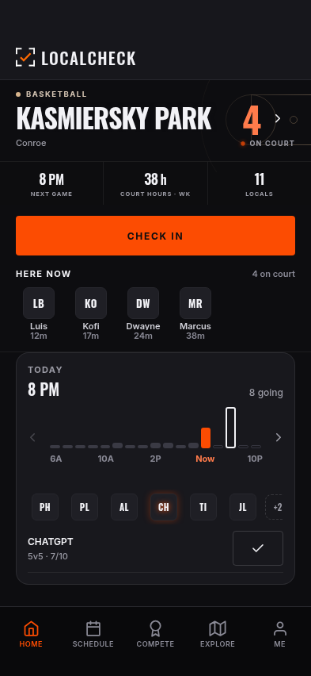
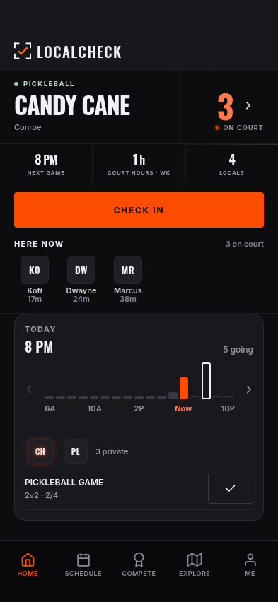
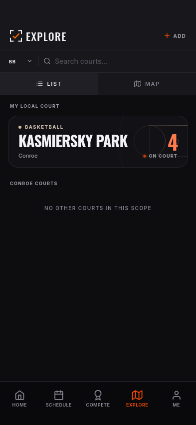
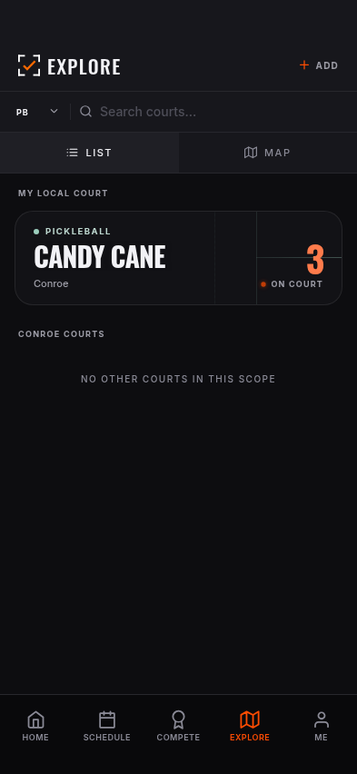

# Current PR preview screenshots — November 6

Screenshot-only checkpoint. No app or backend changes, and no update to PR #90.

- Source: PR #90 head `69757d5ee32f8582052ce5dbbc491a8a8d2928f4`.
- Deployment: https://localcheck-app-preview-59op51heq-jgpt-automated.vercel.app
- Viewport: 393 × 852, Expo web in isolated cloud Chromium.
- Routes: Home (`/`) and Explore (`/explore`), basketball and pickleball.
- Data: intercepted sample sessions and fixtures; no live login or writes.
- These show the deployed PR, not the newer unpublished local UI work.

| Screen | Basketball | Pickleball |
| --- | --- | --- |
| Home |  |  |
| Explore |  |  |
