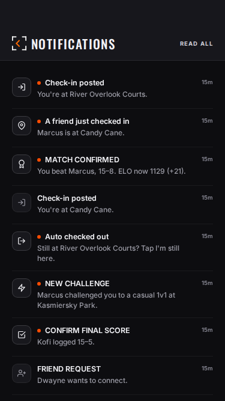
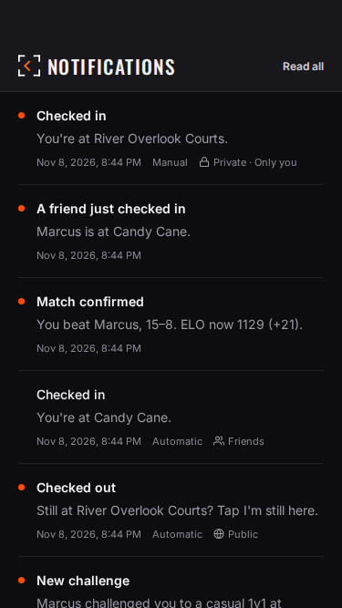
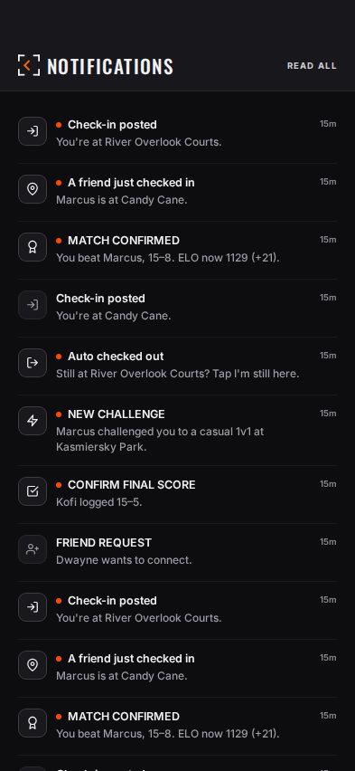
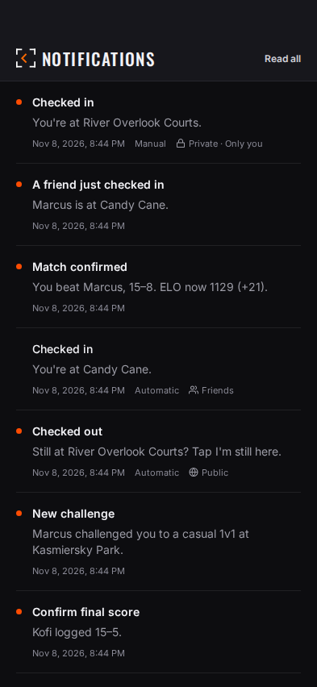
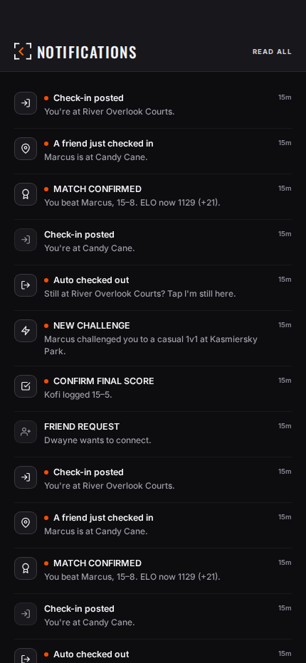
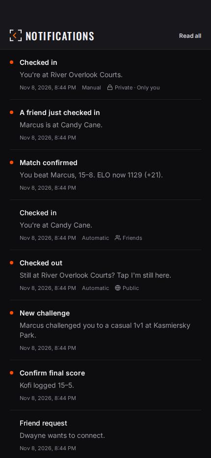

# Notifications: compact log preview

Scope: `/notifications`, existing notification data only. Reuses DetailHeader,
Feather, canonical typography/colors, FlatList and installed React Query.
No schema application, push behavior change, OTA or native build.

Jesse's original [device screenshot](device-inbox-before.png) is unchanged.
It proves a custom diagnostic row appeared in his inbox, not a manual
check-in trigger or privacy path. It is a visual reference, not the automated
before capture (the viewport/data differ).

The UI renders stored own-event visibility only; no legacy audience is inferred.
Private/Friends/Public examples in isolated captures are synthetic metadata
examples, not live privacy snapshots or proof the backend records them today.
Complete manual-event history and snapshot capture are a separate backend slice.

Paging: 20 visible rows, one-row lookahead, created_at/id descending cursor.
Unread count covers all history separately from the loaded pages. Errors keep
loaded rows with retry. Phone-alert preference does not filter inbox history.

## Rendered before / after

Both are actual Expo web exports, same isolated fixtures, Central timezone and
viewport. Baseline is main `19dac699115099bdad33fa1b5feb1d48730fedf6`;
after is the application tree in PR #91 commit
`205dc8f24de44794783a4009eddee69787b039d6`. No network call reached Supabase;
HTTP was fulfilled locally and all WebSockets closed before navigation.

| Size | Before | After |
| --- | --- | --- |
| 375 × 667 |  |  |
| 393 × 852 |  |  |
| 430 × 932 |  |  |

## Checks completed

- `pnpm check`: typecheck, full repository unit suites, design and docs checks passed.
- Fresh production-mode Expo web export completed.
- `notification-log-journey.mjs`: all seven acceptance cases passed at all three
  sizes: 20-row pages, equal-timestamp cursor boundary, 43 unique entries with
  no gaps/duplicates, page failure/retry, Read all, explicit visibility examples,
  and sentence-case headings. Title/body left edges both measured 40px.
- Populated screens: zero clipping/overlap/horizontal overflow and zero audited
  small text, low contrast or small targets at all three sizes; raw
  [results](after/results.json).
- Existing scoped `qa:visual` Notifications empty state: zero failures and
  zero above-baseline debt at all three sizes ([report](empty-state-report.md)).
- GitHub quality, docs updated and Expo PR-preview checks passed on the
  application commit above. Vercel Preview is ready. Local browser could not
  connect directly to Vercel; isolated captures use local exports instead.

Reproduce: export the app, then
`node scripts/visual-qa/notification-log-journey.mjs <export-directory> <output-directory>`.
Use `before` as the last argument for the baseline capture.

Not tested here: native iPhone rendering, VoiceOver/TalkBack, font scaling,
actual push delivery for a changed check-in trigger, complete manual-event
history, or live production paging/RLS with signed-in users. This PR changes
no backend contract. UI approval precedes the missing-event/privacy-snapshot
backend slice; merge does not publish OTA or create a native build.
