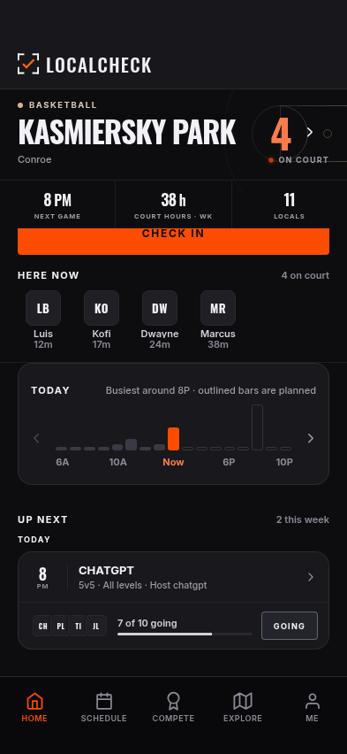
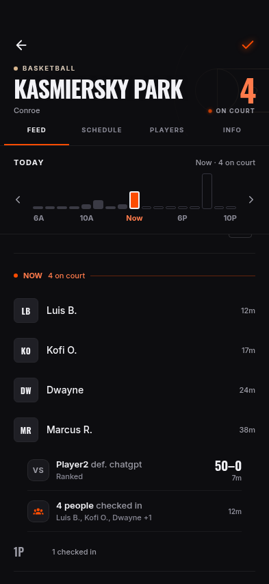
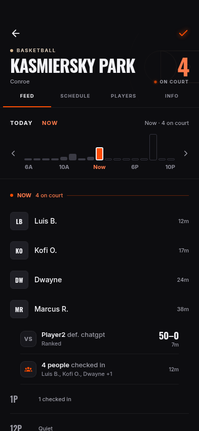
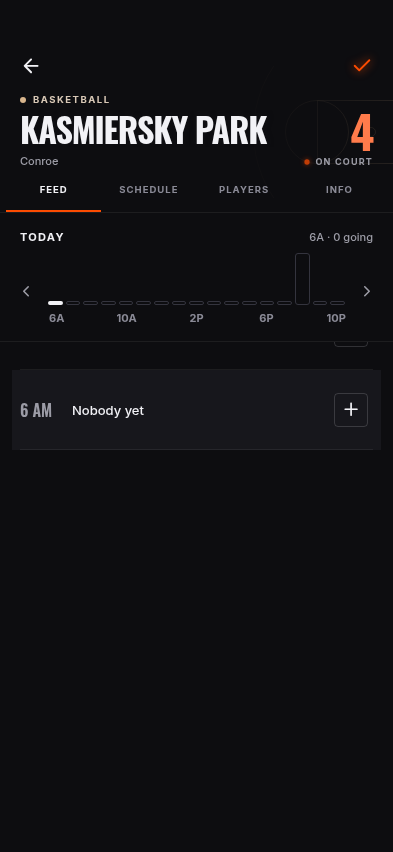
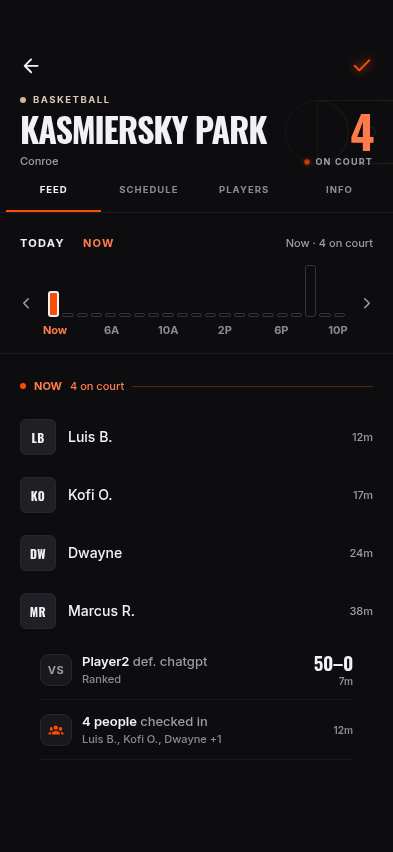
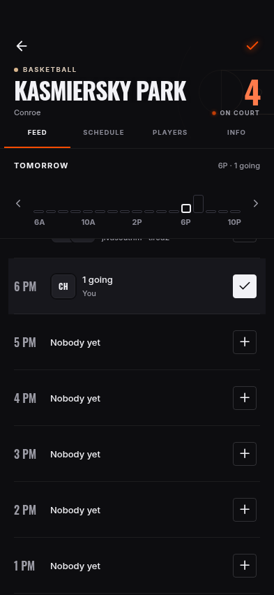
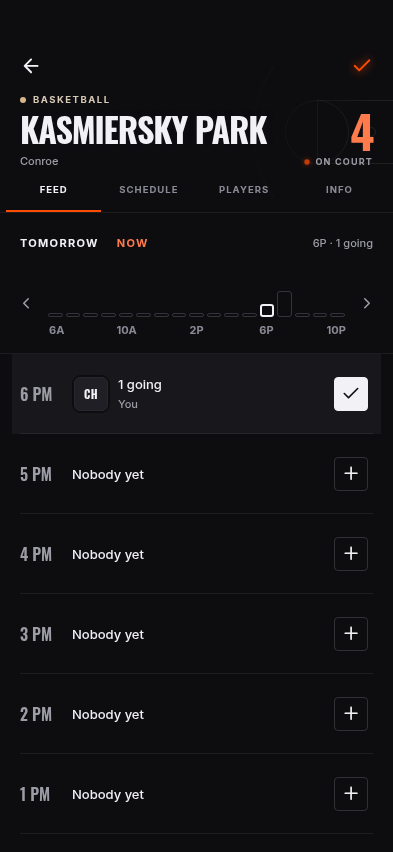
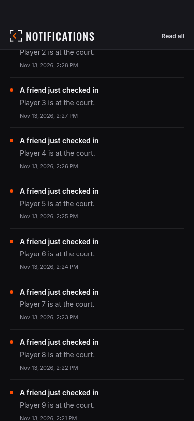

# November 13 finalization: actual app evidence

The existing #90 dashboard and #91 notification work is integrated on
`codex/finalize-courts-notifications`, with corrections for Jesse's November 13
feedback. Before: integration checkpoint `2309de8`; after: the corrections in
this PR, source hashes in [source.sha256](source.sha256). LCv5 `41ebfde` was
inspected for behavior; the current application's design is retained.

All screenshots are actual Expo web renders in Chromium, with isolated
Supabase-shaped fixtures and every WebSocket blocked. No live login, mutation,
production release or device test is represented by these images.

## Before and after — 393 × 852

| State | Before | After |
| --- | --- | --- |
| Home after body scroll |  |  |
| Feed opening at Now |  |  |
| Late-night feed, 2:30 AM |  |  |
| Going confirmed |  |  |
| Compact notifications after scroll |  |  |

Before/after images at 375/393/430 are retained in the corresponding folders.
Night behavior has an additional 393px case. [Home saved-court selection](selectors-dismiss/home-saved-court-393.png)
and [Schedule saved-court selection](selectors-dismiss/schedule-saved-court-393.png)
exercise the new list without changing the profile's default court. The Home
selection journey also waits for the picker to dismiss; the earlier in-flight
selection capture remains in `selectors/`.

## Results

- `pnpm@10.13.1 check`: **273 tests**, TypeScript, design/docs checks pass.
  [Full output](check-results.txt).
- Browser journey at **375×667, 393×852, 430×932**: fixed Home/notification
  header and court chart positions, Now initial navigation, Going save/reload,
  planned activity event, saved court save/reload/Home selection/removal.
  Zero application page errors. Additional Schedule selection journey at 393.
- Home court title: **y=128.75 → 128.75** during body scrolling. Notifications
  title: **y=59.5 → 59.5**. Feed chart: **y=265 → 265**. Current-hour group is
  immediately below the pinned chart, including the 2:30 AM regression.
- Notification journey: **43 unique records**, timestamp tie at the cursor
  boundary, 20-row pages, failure/retry, Read all, recorded audiences and
  sentence case at three sizes. [Results](notifications/results.json).
- [Disposable PostgreSQL result](database-results.txt): saved-court cap,
  idempotency, owner RLS, denied free writes, default and downgrade behavior;
  manual delay, privacy/sharing/recipient/blocking, audience history,
  retry/deduplication and timed checkout. The exact migration source is tested
  over the read-only live function snapshot plus isolated prerequisite tables.
- Scoped visual audit: **9 states × 3 sizes**, **zero hard failures**, **zero
  increase** in small text, contrast or target debt against the before capture.
  [Comparison](audit-comparison.json), [after report](audit-after/report.md).
  The raw runner exits nonzero for **10 inherited Home baseline exceedances**,
  identical before and after. No baseline was raised. This is not a clean
  global accessibility sign-off.

Commands and boundaries are in the [implementation/deployment handoff](../../../plans/2026-11-13-finalize-courts-notifications.md).

## Remaining acceptance

Both database migrations are prepared but **unapplied**. Their behavior is not
live just because the UI has code. No live production RLS/write test, two-device
convergence, QStash dispatch, APNs receipt, iPhone/Safari interaction, Dynamic
Type or native geofencing acceptance was performed. Do not merge/release on a
claim that those were tested. Production SQL follows Jesse's SQL-editor flow;
production OTA is a separate deliberate action after backend/device checks.

## Changed source and authority trail

- [app/(tabs)/schedule.tsx](../../../../app/(tabs)/schedule.tsx)
- [app/court/[id].tsx](../../../../app/court/[id].tsx)
- [app/notifications.tsx](../../../../app/notifications.tsx)
- [app/settings.tsx](../../../../app/settings.tsx)
- [components/HomeScreen.tsx](../../../../components/HomeScreen.tsx)
- [components/ScreenHeader.tsx](../../../../components/ScreenHeader.tsx)
- [components/court/CourtActivityFeed.tsx](../../../../components/court/CourtActivityFeed.tsx)
- [components/court/CourtBusyChart.tsx](../../../../components/court/CourtBusyChart.tsx)
- [components/court/CourtParts.tsx](../../../../components/court/CourtParts.tsx)
- [components/court/SavedCourtList.tsx](../../../../components/court/SavedCourtList.tsx)
- [components/game/LogGameForm.tsx](../../../../components/game/LogGameForm.tsx)
- [components/ui/ActivityRow.tsx](../../../../components/ui/ActivityRow.tsx)
- [components/ui/CourtSearchPicker.tsx](../../../../components/ui/CourtSearchPicker.tsx)
- [components/ui/HomeCourtHero.tsx](../../../../components/ui/HomeCourtHero.tsx)
- [constants/data.ts](../../../../constants/data.ts)
- [context/AppContext.tsx](../../../../context/AppContext.tsx)
- [docs/CURRENT_STATE.md](../../../../docs/CURRENT_STATE.md)
- [docs/FEEDBACK_TRACKER.md](../../../../docs/FEEDBACK_TRACKER.md)
- [docs/RELEASE.md](../../../../docs/RELEASE.md)
- [docs/SUPABASE.md](../../../../docs/SUPABASE.md)
- [docs/plans/2026-11-13-finalize-courts-notifications.md](../../../../docs/plans/2026-11-13-finalize-courts-notifications.md)
- [docs/product/DECISIONS.md](../../../../docs/product/DECISIONS.md)
- [docs/product/DESIGN.md](../../../../docs/product/DESIGN.md)
- [docs/product/PRODUCT.md](../../../../docs/product/PRODUCT.md)
- [lib/courtBusyModel.test.mts](../../../../lib/courtBusyModel.test.mts)
- [lib/courtBusyModel.ts](../../../../lib/courtBusyModel.ts)
- [scripts/visual-qa/finalize-courts-journey.mjs](../../../../scripts/visual-qa/finalize-courts-journey.mjs)
- [services/feedService.ts](../../../../services/feedService.ts)
- [services/plannedVisitService.ts](../../../../services/plannedVisitService.ts)
- [services/savedCourtService.ts](../../../../services/savedCourtService.ts)
- [supabase/migrations/20261113100000_saved_courts.sql](../../../../supabase/migrations/20261113100000_saved_courts.sql)
- [supabase/migrations/20261113110000_complete_check_in_notifications.sql](../../../../supabase/migrations/20261113110000_complete_check_in_notifications.sql)
- [supabase/tests/database/finalize-courts.mjs](../../../../supabase/tests/database/finalize-courts.mjs)
- [supabase/tests/database/fixtures/20261113-notification-functions.sql](../../../../supabase/tests/database/fixtures/20261113-notification-functions.sql)
