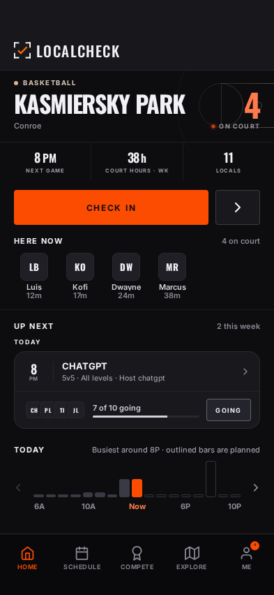
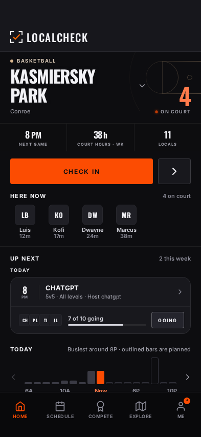
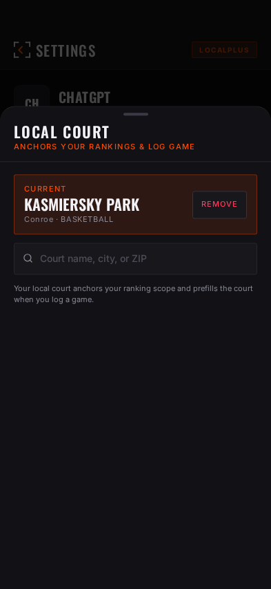
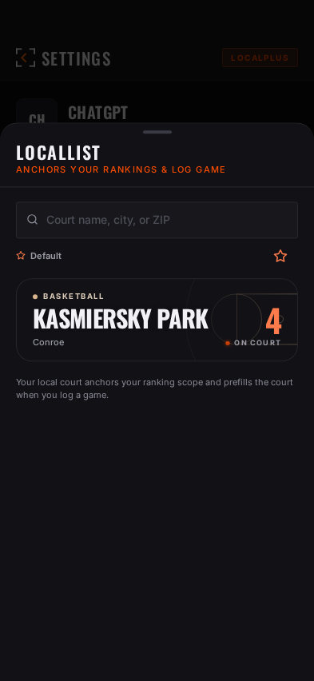
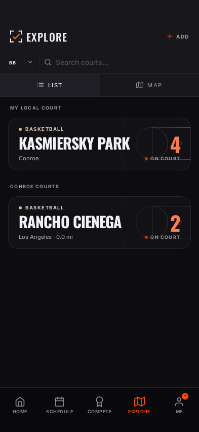
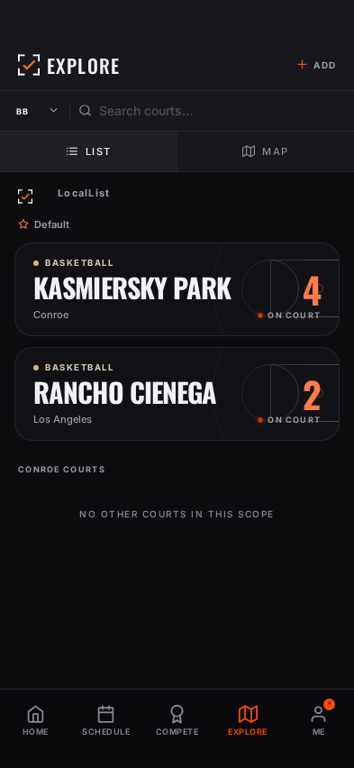
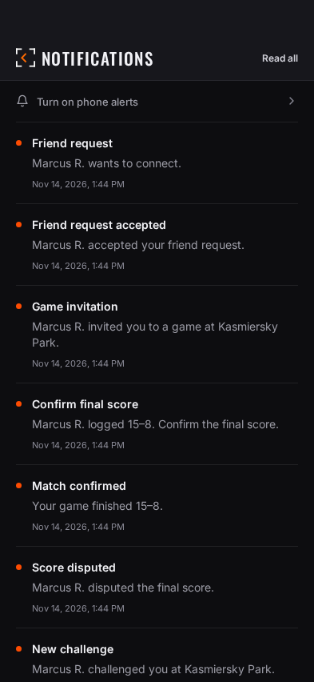

# LocalList and Home check-in UI

Built from PR #91 at `3e12738fc02fc95ed371cd477be31e779fc84fdb` on
`codex/inbox-locallist-home`. No #90 implementation or SQL was imported.
The AFTER screenshots use a fresh Expo web export of this branch's application
changes; BEFORE is an independent export of the exact #91 base. Same fixture,
viewport, clock and timezone for the paired journey screenshots.

## What changed

- Court-page plus adds to the current account's LocalList UI draft. Explore
  lists the existing shared court heroes, default first. Settings puts search
  above aligned cards, with a star to choose the default and remove controls
  on the other courts. LocalPlus entitlement and five-court limit apply.
- Home adds a court-name dropdown, horizontal paging and short indicator lines.
  Settings chooses the default; Home/Schedule choices only change that page.
  Returning to Home after changing Settings uses the new default.
- LOCALCHECK stays left in the header. Pending/active states make it orange.
  Automatic pending shows Posts in with a countdown; confirmed manual/automatic
  sessions show elapsed time from the stored checked_in_at. The header has no
  buttons. The hero stays fixed and flush beneath it; the action row and court
  arrow keep their original location and order.
- Inbox keeps #91's compact rows, exact local timestamps, 20-row cursor pages
  and push-independent reads. Own manual and automatic check-in/out types share
  source/audience presentation. Audience is shown only when stored on the
  event; current profile privacy is never substituted for missing history.
- Court titles can wrap to two lines on small phones. Court-drawer navigation
  unmounts its modal content and ignores late resnap callbacks after dismissal,
  preventing an invisible layer from blocking the next screen's tabs.

## Explicit boundaries

LocalList additions and its default are **in-memory UI state** for this pass:
app reload restores the server's current local court. No new tables, RPC,
device storage, geofence list or notification writer was added. The existing
live check-in/cancel endpoints remain the actions used by the app.

**Post is visible but disabled.** The live backend has no atomic action to
confirm a pending automatic check-in early. Using the manual or resume action
would change its source/timestamp or leave the pending arrival behind. This
backend operation remains a separate slice. Cancel uses the existing pending
undo operation. Countdown zero does not invent successful posting.

Read-only live function inspection confirmed that manual check-in creates its
check-in and activity immediately, so no one-minute delay was introduced.
Automatic posting retains its existing five-minute grace window. Session
expiration policy, notification delivery/creation, account/event deletion and
previous-game handling were not changed. No migration, backend write, deploy,
merge, OTA or native build was performed.

## Before / after

Actual rendered Expo routes, not design mockups. The before column is #91,
not main. Open each image to inspect it at full size.

| Surface, 393 × 852 | Before #91 | After |
| --- | --- | --- |
| Home |  |  |
| Settings court drawer |  |  |
| Explore |  |  |
| Inbox |  |  |

| New state | 375 × 667 | 393 × 852 | 430 × 932 |
| --- | --- | --- | --- |
| LocalList dropdown | [375](after/home-picker-375.png) | [393](after/home-picker-393.png) | [430](after/home-picker-430.png) |
| Second court | [375](after/home-selected-375.png) | [393](after/home-selected-393.png) | [430](after/home-selected-430.png) |
| Settings default | [375](after/settings-list-default-375.png) | [393](after/settings-list-default-393.png) | [430](after/settings-list-default-430.png) |
| Schedule list | [375](after/schedule-list-picker-375.png) | [393](after/schedule-list-picker-393.png) | [430](after/schedule-list-picker-430.png) |
| Automatic pending | [375](after/home-pending-375.png) | [393](after/home-pending-393.png) | [430](after/home-pending-430.png) |
| Manual active | [375](after/home-manual-active-375.png) | [393](after/home-manual-active-393.png) | [430](after/home-manual-active-430.png) |
| Automatic active | [375](after/home-auto-active-375.png) | [393](after/home-auto-active-393.png) | [430](after/home-auto-active-430.png) |
| Court plus | [375](after/court-add-375.png) | [393](after/court-add-393.png) | [430](after/court-add-430.png) |

[Recorded own-event privacy example](after/inbox-privacy-393.png).
The notification data in these captures is synthetic, including manual-event
rows and privacy metadata. Rendering them proves the UI supports those records;
it does not claim that today's backend creates every event or privacy snapshot.

## Verification

- Full `pnpm check`: 281 tests, TypeScript, design and documentation checks pass.
- Fresh Expo web export through `scripts/start-web-preview.sh --export-only`.
- Three-size actual UI journey: 45 captured states, zero page errors and zero
  audited clipping/overlap/off-screen text failures. HTTP is intercepted before
  navigation and WebSockets are closed: no live service mutation or push send.
- Add from court plus → existing Explore list → Home dropdown and scroll →
  Settings star → Home default → Schedule selection → unchanged Home default.
- Header/hero boundary measured less than 1px apart; scrolling leaves hero top
  unchanged. Header contains zero buttons. Search bottom is above the card
  list's top. Elapsed timer stays within the right header gutter at all sizes.
- Twelve incoming/own-event types render with phone alerts off. A 43-record
  list loads across three pages and Read all clears the unread action.
- Pending Cancel succeeds, manual check-in posts immediately, Post is disabled,
  and an automatic session started ten minutes earlier displays 10:00.
- Existing inbox failure/retry journey rerun at 393px: 43 unique records,
  equal-timestamp page boundary, no duplicates/gaps, retry, read-all, privacy
  examples and sentence case all pass. Title/body left edges both 40px.

Raw [journey results](after/journey-results.json) and
[inbox retry results](after/inbox-retry-results.json). The results include the
existing small text/target debt reported by the shared audit; no new contrast
failure appears in any captured journey state. Scoped canonical-surface results
and the [same-fixture comparison](canonical-comparison.md) show zero layout
failures and no increased debt on any of the 27 canonical screen/size pairs.
The older checked-in debt baseline still flags inherited Home text/targets;
its thresholds were not raised. See the raw before/after reports for those
nonzero historical-baseline results.

These are isolated Expo web renders. Native keyboard/font scaling, VoiceOver/
TalkBack, OS geofences and push delivery are outside this UI evidence.

Reproduce with installed dependencies and the project's public environment:

```sh
./scripts/start-web-preview.sh --export-only
CHROMIUM_PATH=<browser> node scripts/visual-qa/locallist-home-journey.mjs <export-directory> <output-directory>
CHROMIUM_PATH=<browser> NOTIFICATION_WIDTH=393 node scripts/visual-qa/notification-log-journey.mjs <export-directory> <output-directory>
QA_ONLY=home-feed,home-scrolled,court-live,explore,settings,notifications,schedule-court-picker QA_SIZES=375x667,393x852,430x932 CHROMIUM_PATH=<browser> node scripts/visual-qa/run.mjs <export-directory> --out <output-directory>
pnpm check
```

## Source trail relative to #91

The PR diff is the complete change list. Files below contain the new UI,
shared state, timestamp reader, presentation tests and accompanying docs:

- `app/(tabs)/schedule.tsx`
- `app/_layout.tsx`
- `app/court/[id].tsx`
- `app/notifications.tsx`
- `app/settings.tsx`
- `components/CourtListItem.tsx`
- `components/CourtsScreen.tsx`
- `components/HomeScreen.tsx`
- `components/ScreenHeader.tsx`
- `components/brand/LogoMark.tsx`
- `components/court/CourtParts.tsx`
- `components/court/LocalListCards.tsx`
- `components/home/HomeCourtCarousel.tsx`
- `components/home/HomeSessionStatus.tsx`
- `components/home/homeStatusModel.test.mts`
- `components/home/homeStatusModel.ts`
- `components/sheet/CourtSheetHost.tsx`
- `components/ui/HomeCourtHero.tsx`
- `context/AppContext.tsx`
- `context/LocalListContext.tsx`
- `docs/CURRENT_STATE.md`
- `docs/FEEDBACK_TRACKER.md`
- `docs/plans/2026-11-14-inbox-locallist-home.md`
- `docs/product/DECISIONS.md`
- `docs/product/DESIGN.md`
- `docs/product/PRODUCT.md`
- `lib/localListModel.test.mts`
- `lib/localListModel.ts`
- `lib/notificationPresentation.test.mts`
- `lib/notificationPresentation.ts`
- `package.json`
- `scripts/visual-qa/locallist-home-journey.mjs`
- `services/checkInService.ts`
- `services/notificationService.ts`
