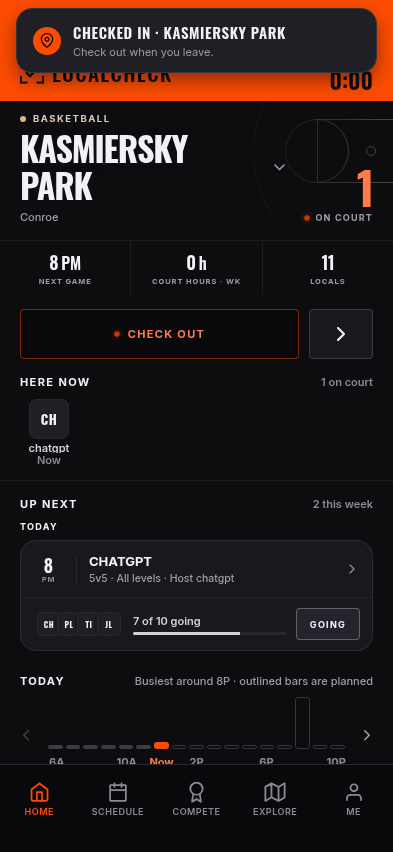
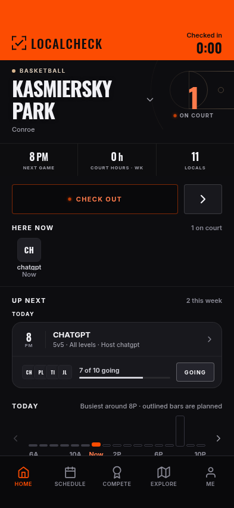
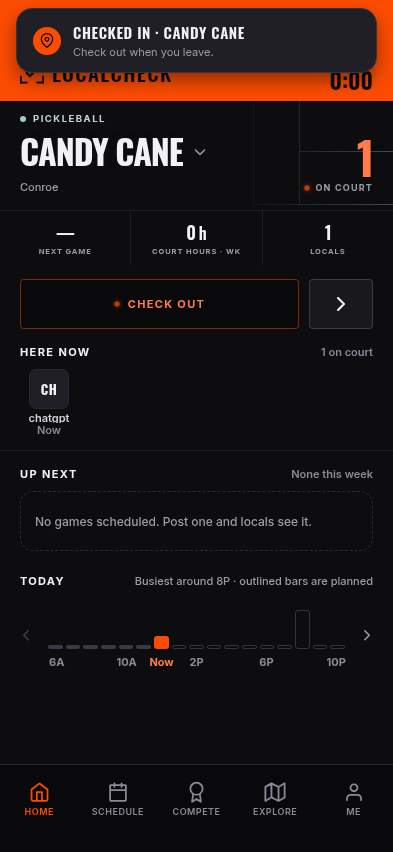
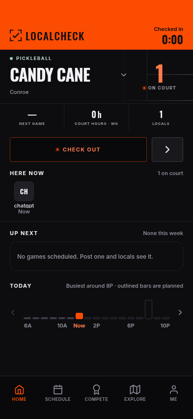

# November 17 — remove app banners and stabilise court headers

One small correction on PR #92. Application source `d7cbf8d` (final count-fit
correction), following `d1e0485` (banner removal/shared header). Baseline is
immutable PR92 `3e42aa092e19200a12c796e33646acb97fa8a9a6`.

## Rendered change

Same 393×852 viewport, court, clock and isolated one-player check-in:

| Before | After |
| --- | --- |
|  |  |
|  |  |

The former live column widened when its dot appeared. At 393px this shrank
the title column by 11px (279.375 → 268.375), wrapping Kasmiersky Park from one
line to two; the bottom-aligned live block then sat 24.5px below the identity's
centre. The temporary check-in banner also covered the app header.

The new live column is fixed at 96px for page/Home and 88px for cards. Its
number/label group is centred against the identity. At 375/393/430px, Home's
title column stays 223/241/278px before and after check-in for both sports;
live-block centre offset is 0px. Names wrap at their original font size rather
than being squeezed or cut to two lines. No temporary banner is rendered.

The final ~1000 stress case fits inside its 96px slot at all three widths:
85.59px text width, 5.20px clearance on either side. This correction changes
only values longer than four characters; ordinary counts retain their size.

## What was opened and measured

- Both sports: zero → one actual mocked check-in, at 375×667, 393×852,
  430×932 after the main correction. The immutable before run contains full
  393/430 pairs. No partial baseline run is included here.
- Shared owner: Explore card, court drawer and full court page, both sports
  at 393px. The lead opened the rendered Home/card/drawer/page images and
  compared their title/count treatment, then inspected the final 375px stress
  render and final 393px checked-in render.
- Final application `d7cbf8d`: six stress renders (both sports/three sizes)
  and fresh 393px zero/one pairs confirm the last count-fit change.
- A final 375px `KASMIERSKY RECREATION PARK` fixture wraps to three lines;
  the live group stays centred with 0px offset and no name/count overlap.
  [Three-line render](final/long-name-375/basketball-home-375-count-1.png).
- Page errors: zero. Home action banner count: before 1, after 0.
- Existing native haptics and screen-reader announcements remain; OS push
  notifications and the inbox were not redesigned by this change.

## Reproduction and raw evidence

The harness uses existing `mock.mjs`/`fixtures.mjs`. All backend HTTP is
fulfilled or aborted before navigation and WebSockets are closed. Check-in
writes only to fixture memory. These are browser renders, not production
players or native phone captures.

```bash
TMPDIR=/tmp PORT=8125 corepack pnpm@10.13.1 preview:web
EXPECT_CENTERED_TITLE=1 EXPECT_NO_TOAST=1 \
  node scripts/visual-qa/court-header-journey.mjs \
  http://127.0.0.1:8125 /tmp/court-header-after
```

Use `SIZES=393,430 HOME_PAIR_ONLY=1` for the short baseline pair run.
Use `STRESS_ONLY=1` for the final long-count fit check plus 393px check-in.
Use `SIZES=375 HOME_PAIR_ONLY=1 COURT_QA_NAME="KASMIERSKY RECREATION PARK"`
for the three-line name case with the same isolated journey.
The before URL was
`https://localcheck-app-preview-rg6xbtm7l-jgpt-automated.vercel.app`.

- [Before measurements](before/measurements.json).
- [Main after measurements](after/measurements.json), source `d1e0485` on port8124.
- [Final fit measurements](final/measurements.json), source `d7cbf8d` on port8125.
- [Portable journey](../../../../scripts/visual-qa/court-header-journey.mjs).

Local type/model/design/docs checks and the final typecheck were run. Visual
conclusions above come from the measured and opened app renders.

## Exact source trail and next slice

- `components/ui/Toast.tsx`: remove the visual banner; retain the existing API,
  native haptics and accessibility announcement.
- `components/court/CourtParts.tsx`: stable live-column width, centred group,
  natural title wrapping and long-value fit. Used by all four court surfaces.
- Authority docs: CURRENT_STATE, FEEDBACK_TRACKER, product/DECISIONS,
  product/DESIGN and product/PRODUCT.

The next requested visible slice is Settings drawer spacing/footer/removal and
Explore's LOCAL LIST heading. LocalList persistence, its reviewed database
change, manual/automatic push delivery and a subsequent phone release remain
separate pending work. No completion claim for them follows from these images.
