# Explore correction and four-surface hero proof

On PR #93, on branch; no merge, production OTA, native build or backend change.
This supersedes the initial November 17 screenshot handoff.

## What was wrong and what changed

| Observed problem | Correction / shared owner |
| --- | --- |
| LocalList had a second logo and a different section heading | LOCAL LIST and HOUSTON COURTS use the same sectionLabel and spacing tokens in CourtsScreen |
| Default status floated above its court | Neutral star belongs to the saved CourtListItem through CourtTitleRow; no detached Default row in browse mode |
| The marker could change one card's height | Shared 16pt metadata row; identical card structure for default and other courts |
| Long names wrapped and cards grew unevenly | Existing short name / full-name fallback and shared native/web font fitting |
| Artwork alignment differed by page | CourtTitleRow owns the numeral frame and CourtArtGeometry on every surface |
| Count/label group was centered, but numeral was off the circle center | 64pt numeral frame, measured Oswald optical offset; ON COURT below the circle |
| Four digits fit the count column but exceeded the circle | Same native/web fitting helper used for the number, constrained to the circle |
| First court tap could be ignored after #92 conditionally mounted the drawer | CourtSheetHost presents after mount and lets Gorhom update measured detents; the duplicate stale snap command is removed |
| Tiny Explore/selector text and faint search placeholder | Existing 11pt text token and readable muted color, through canonical components |
| Clear search had a small visual hit box | Canonical SearchField clear uses Layout.minTouchTarget (44pt) |

Settings' notification switch is unchanged. Settings management actions and
Schedule redesign remain separate work; these captures certify the hero and
Explore corrections, not every feature in those screens.

## Rendered proof

Screenshots are actual Expo web renders, with HTTP/WebSockets isolated from
production. They contain fixtures, not real-player activity. Before uses the
previous #93 deployment at 149b317; after uses the current source. Same names,
counts, and widths. All four requested surfaces are captured, including the
actual expanded drawer detent (not just its peek).

## 375-point phone

| Explore | Home | Court detail | Expanded drawer |
| --- | --- | --- | --- |
| [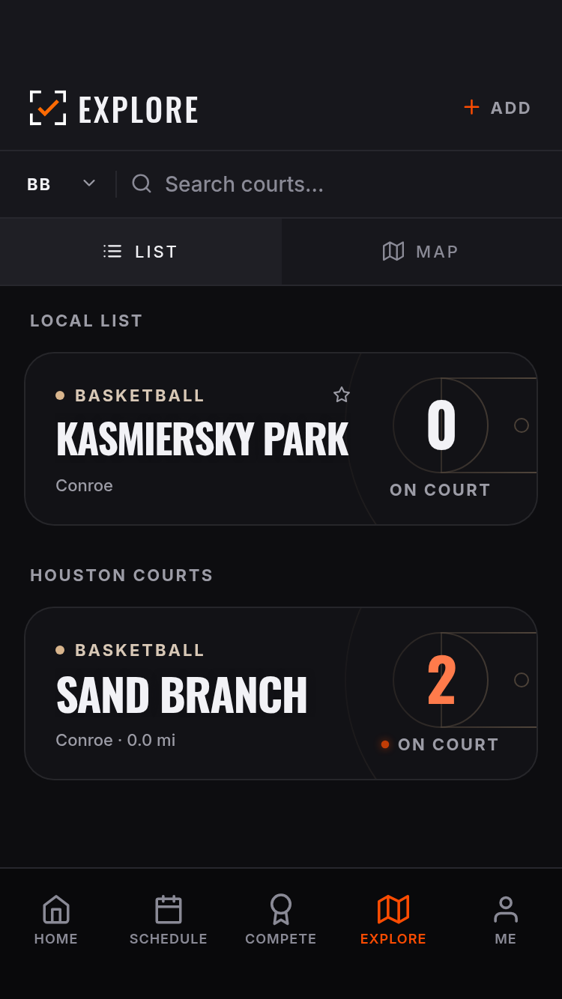](after/explore-375-short.png) | [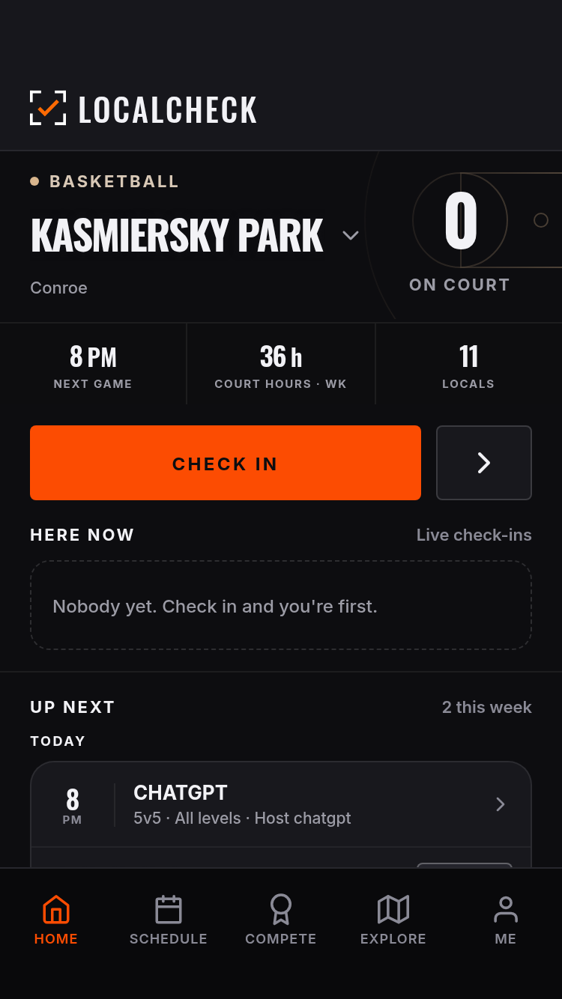](after/home-375-short.png) | [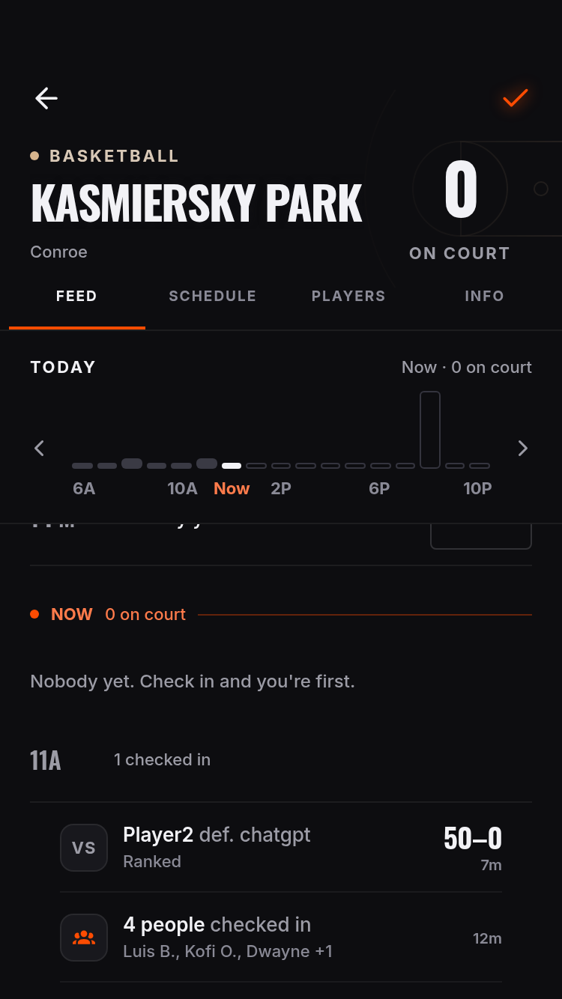](after/court-375-short.png) | [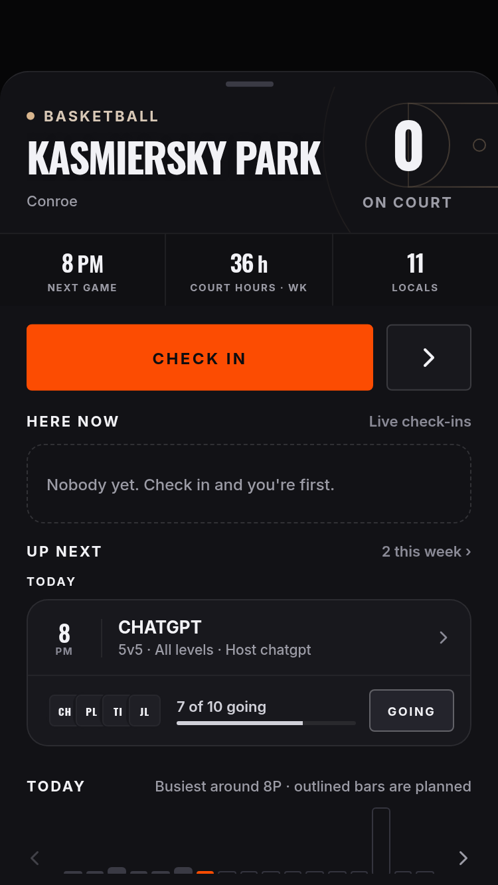](after/drawer-expanded-375-short.png) |

[Before / after details](#file-trail)

## 393-point phone

| Explore | Home | Court detail | Expanded drawer |
| --- | --- | --- | --- |
| [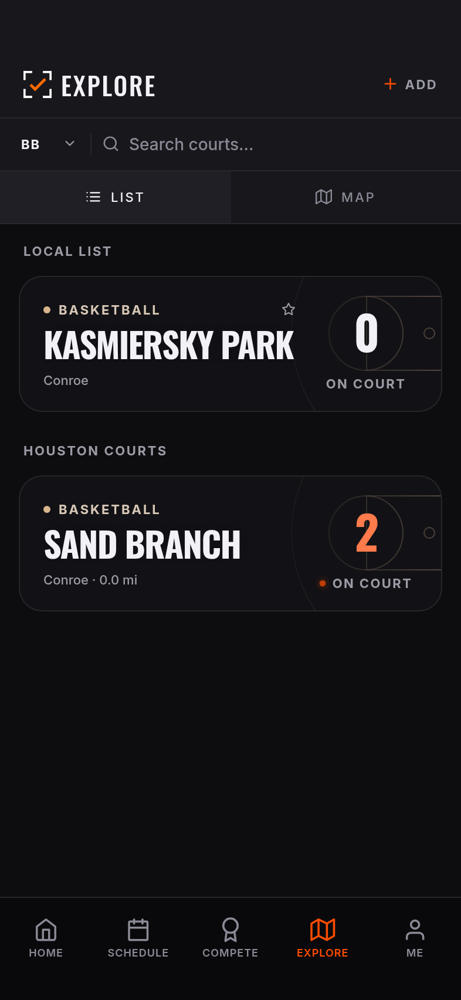](after/explore-393-short.png) | [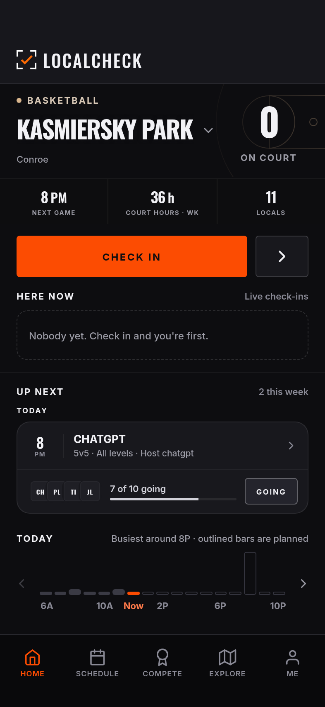](after/home-393-short.png) | [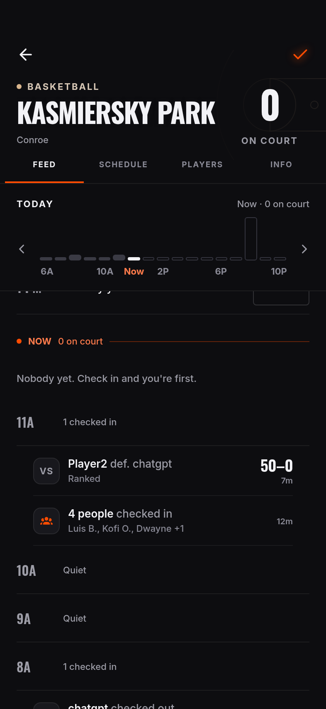](after/court-393-short.png) | [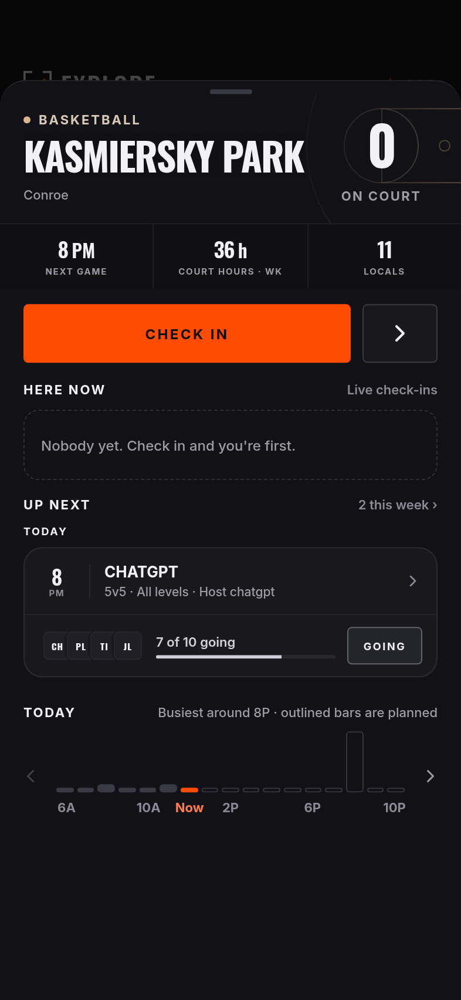](after/drawer-expanded-393-short.png) |

[Before / after details](#file-trail)

## 430-point phone

| Explore | Home | Court detail | Expanded drawer |
| --- | --- | --- | --- |
| [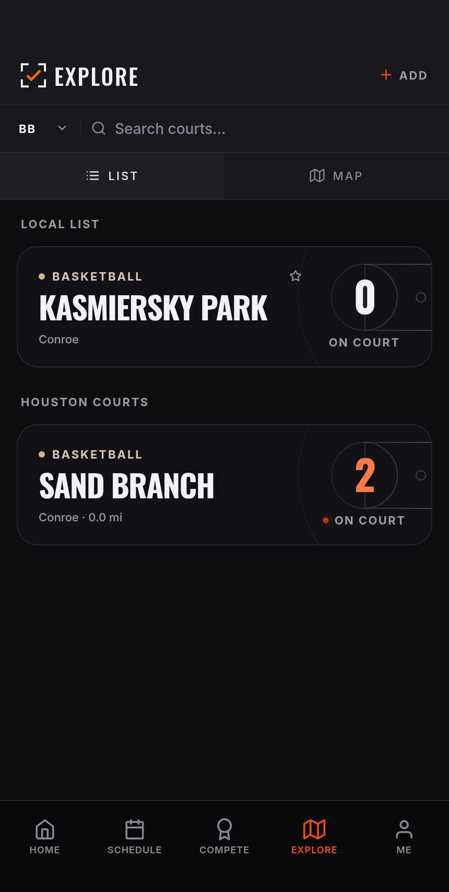](after/explore-430-short.png) | [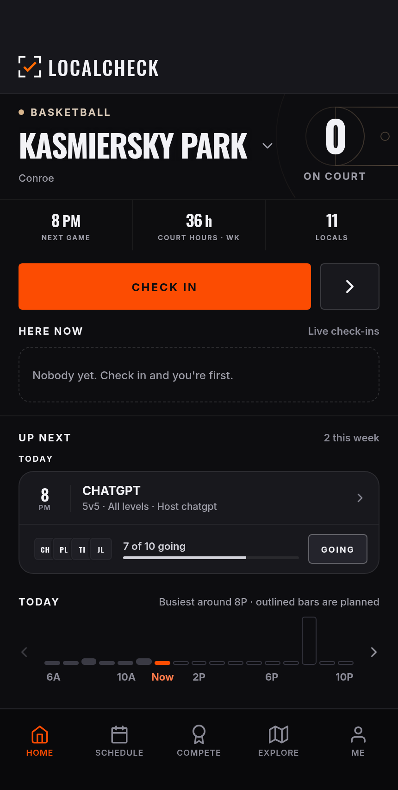](after/home-430-short.png) | [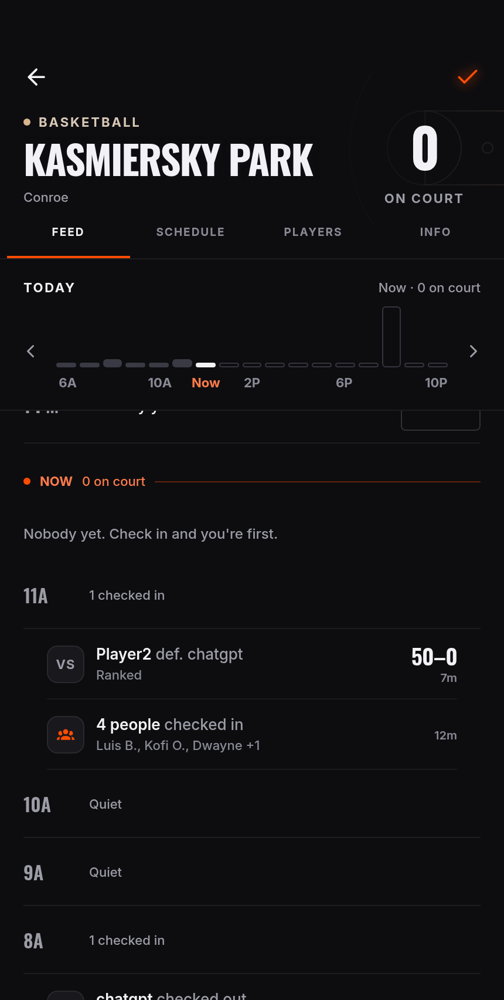](after/court-430-short.png) | [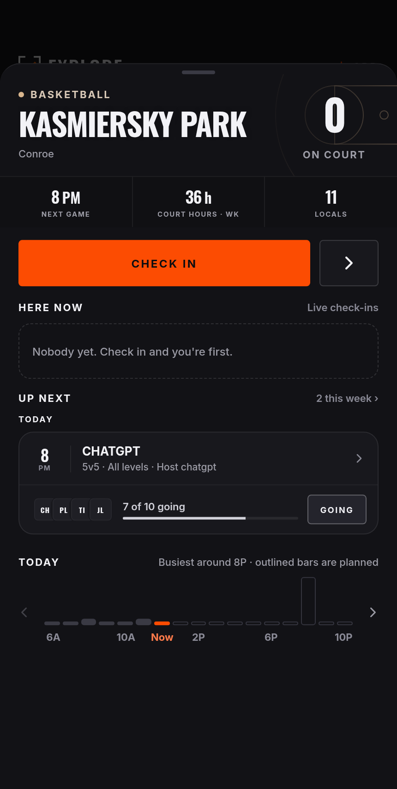](after/drawer-expanded-430-short.png) |

[Before / after details](#file-trail)

## Verification contract

- Four widths: 320, 375, 393, 430. Both short-name preference and a full-name fallback.
- Equal card heights; full title fits; default/market heading tokens and gutters match; one default marker.
- Numeral fits the circle; its caption clears the circle; count columns remain stable; actual 1000 is rendered in the stress cases.
- Search result, empty search, clear, PB/BB filtering, adding a second saved court without duplicating it in discovery.
- Home, Explore, court detail, peek and expanded drawer; reused Settings cards.
- Basketball/pickleball zero-to-one check-in journey, fixture isolated.
- Me inbox / Schedule picker / Log Game / Settings callers checked after shared SearchField/CompactSelect changes.

`pnpm check`, TypeScript and `git diff --check` pass. The shared visual audit
reports clipping/overlap separately from pre-existing small-text/touch-target
debt in other content. Baselines were not increased. Exact receipts and counts
are stored alongside the screenshots.

The test harness now handles literal ILIKE % wildcards without decoding them
a second time. This fixes the fixture server, not production search behavior.

## Limits

Native iOS/Android fitting, Dynamic Type and native safe areas are NOT RUN.
The PR remains draft pending phone acceptance. There is no claim that browser
measurements prove native rendering, and no production release is authorized.
Arbitrarily long unaliased names below the readability floor are not certified.

## File trail

- components/CourtsScreen.tsx — matching sections and Explore supporting roles.
- components/CourtListItem.tsx; components/court/LocalListCards.tsx — attached default marker.
- components/court/CourtParts.tsx; components/court/CourtArt.tsx — shared numeral/circle/metadata geometry.
- components/court/CourtName.tsx; components/court/CourtName.web.tsx — reused title/count fitting from first #93 commit.
- components/sheet/CourtSheetHost.tsx — mounted presentation and removal of duplicate stale resnapping; no retry loop.
- components/ui/CompactSelect.tsx; components/ui/SearchField.tsx — shared type/contrast/clear target.
- scripts/visual-qa/compact-court-journey.mjs; court-header-journey.mjs; mock.mjs — interaction/geometry receipts and fixture decoding.
- docs/CURRENT_STATE.md; docs/FEEDBACK_TRACKER.md; docs/product/DESIGN.md; docs/product/PRODUCT.md; docs/product/DECISIONS.md — authority updates.
- The November 17 gallery is retained and marked superseded; no old screenshots deleted.

## Drawer diagnosis

The captured library trace shows a measured point changing 532→595. A queued manual snap then targets the old 532, which is absent from the new set; the library resolves it to index -1 and dismisses. The fix removes manual resnapping and uses the library’s existing response to snap-point changes. See drawer-diagnosis.json. The check requires the peek to remain open and the expanded header to reach the expanded detent; it cannot score the underlying page as drawer evidence.

## Confirmed checkpoint — November 22

- 52 strict route/state renders pass at 320/375/393/430.
- 18 additional short-name/first-open renders pass independently at 375/393/430.
- Both Explore cards measure **116pt** at all four widths. Their metadata and count/caption use the same structure; no default-only height change.
- Numeral frame/circle centers coincide, the count text fits the 64pt circle, and caption clearance is at least **4.5pt** in the tested states.
- Search result/empty/clear, PB→BB and adding a second saved court pass without duplicating it in discovery.
- `pnpm check` and `git diff --check` pass. The latest 15-state visual audit has zero clipping/overlap/off-screen failures. Existing Home body-content debt remains recorded rather than hidden by raising the baseline.
- The optional marker, search and selector changes have been inspected through their shared owners; the 30-state shared-control caller audit has zero clipping/overlap/off-screen failures.

[Exact receipts](verification.txt) · [Layout measurements](after/measurements.json) · [Drawer trace](drawer-diagnosis.json) · [Visual audit](audit/report.md)

## Matched before / after

### explore

| Width | Before | After |
| --- | --- | --- |
| 375 | [Before](before/explore-375-short.png) | [After](after/explore-375-short.png) |
| 393 | [Before](before/explore-393-short.png) | [After](after/explore-393-short.png) |
| 430 | [Before](before/explore-430-short.png) | [After](after/explore-430-short.png) |

### home

| Width | Before | After |
| --- | --- | --- |
| 375 | [Before](before/home-375-short.png) | [After](after/home-375-short.png) |
| 393 | [Before](before/home-393-short.png) | [After](after/home-393-short.png) |
| 430 | [Before](before/home-430-short.png) | [After](after/home-430-short.png) |

### court

| Width | Before | After |
| --- | --- | --- |
| 375 | [Before](before/court-375-short.png) | [After](after/court-375-short.png) |
| 393 | [Before](before/court-393-short.png) | [After](after/court-393-short.png) |
| 430 | [Before](before/court-430-short.png) | [After](after/court-430-short.png) |

### drawer-expanded

| Width | Before | After |
| --- | --- | --- |
| 375 | [Before](before/drawer-expanded-375-short.png) | [After](after/drawer-expanded-375-short.png) |
| 393 | [Before](before/drawer-expanded-393-short.png) | [After](after/drawer-expanded-393-short.png) |
| 430 | [Before](before/drawer-expanded-430-short.png) | [After](after/drawer-expanded-430-short.png) |

[Search result](after/explore-search-375-short.png) · [Empty search](after/explore-search-empty-375-short.png) · [Two saved courts](after/explore-two-saved-375-short.png) · [1000 inside circle](after/explore-320-four-digit.png)
