# Main Settings row checkpoint — November 22, 2026

On branch `codex/restore-compact-explore-cards`, draft [PR #93](https://github.com/jGPT-Automated/LocalCheck_Expo/pull/93). Implementation and evidence commit: `715893f`. Browser-verified; native acceptance pending.

## Exact scope

Main Settings rows only. One `components/ui/SettingsRow.tsx` replaces the three local row implementations. Reuses existing colors, spacing and TextStyles, the existing page groups, Feather icons and React Native Switch. Grouped-row reference: [Rebeca Zuccari — Settings Mobile App UI](https://dribbble.com/shots/25762551-Settings-Mobile-App-UI), a design concept rather than evidence of shipped behavior.

- Primary labels and values: 14pt; supporting copy: 12pt; existing section labels: 11pt.
- Screen gutters: 20pt; group inner gutters: 16pt; vertical row padding: 12pt. Single-line navigation rows minimum 56pt, description rows minimum 64pt; content can grow.
- Icons and trailing controls center against the whole row. Long values wrap instead of one-line truncation.
- Push switch presentation is explicitly changed: remove the fixed 52pt wrapper, reserve intrinsic width, retain a 44pt minimum accessory height. No scale is applied. The old unused 0.82 transform style is removed. RN Web's separate active-thumb property maps to white; the native control keeps its existing white thumb/orange track configuration.
- Notification callback, save handler, disabled state, navigation actions, section order and wording are preserved. LocalList editor, notification delivery and backend behavior are outside this checkpoint.

## Matched actual renders

Before: deployed previous PR checkpoint `5da6d72`. After: current Settings source, served from `pnpm preview:web`. Same fixed clock, isolated fixture data, widths and route. Images are Expo web renders at 2x, not generated mockups or native captures. Section views are scrolled to their heading; a shorter before page can reach its scroll limit earlier.

| State / width | Before | After |
| --- | --- | --- |
| top, 393pt, normal | [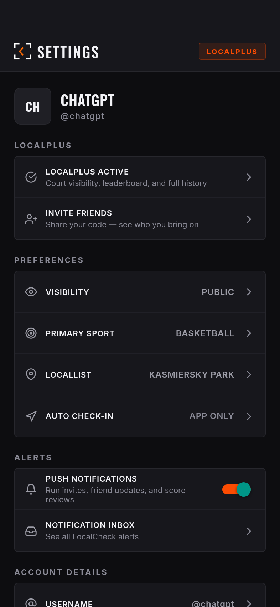](before/settings-top-393-normal.png) | [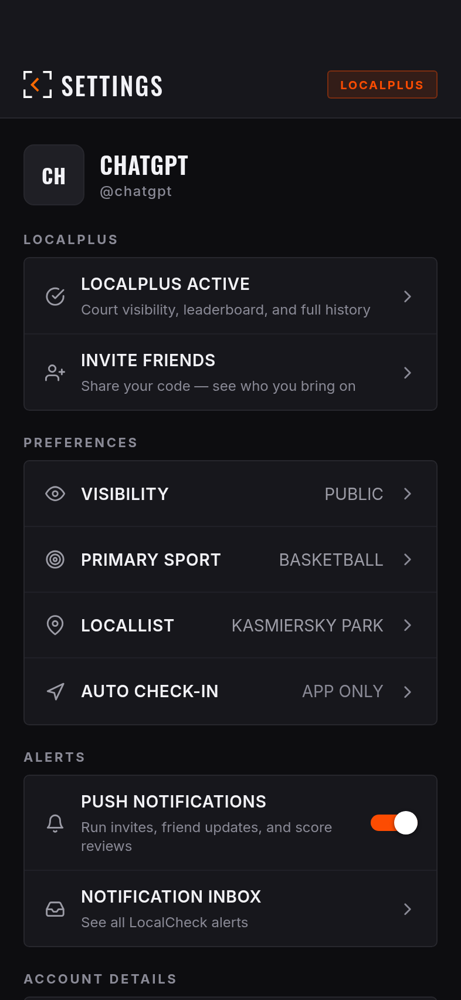](after/settings-top-393-normal.png) |
| preferences, 393pt, normal | [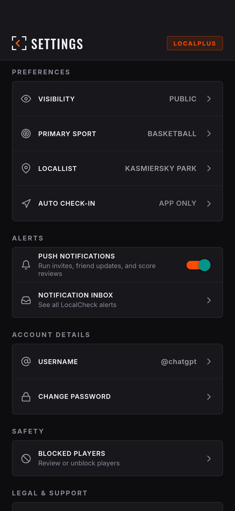](before/settings-preferences-393-normal.png) | [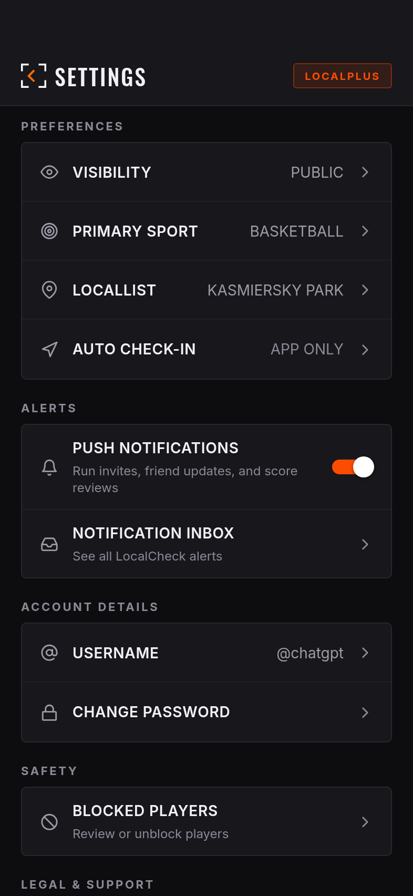](after/settings-preferences-393-normal.png) |
| alerts, 393pt, normal | [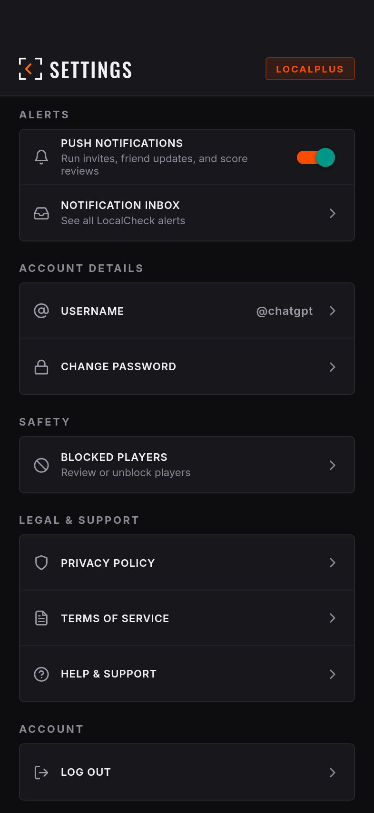](before/settings-alerts-393-normal.png) | [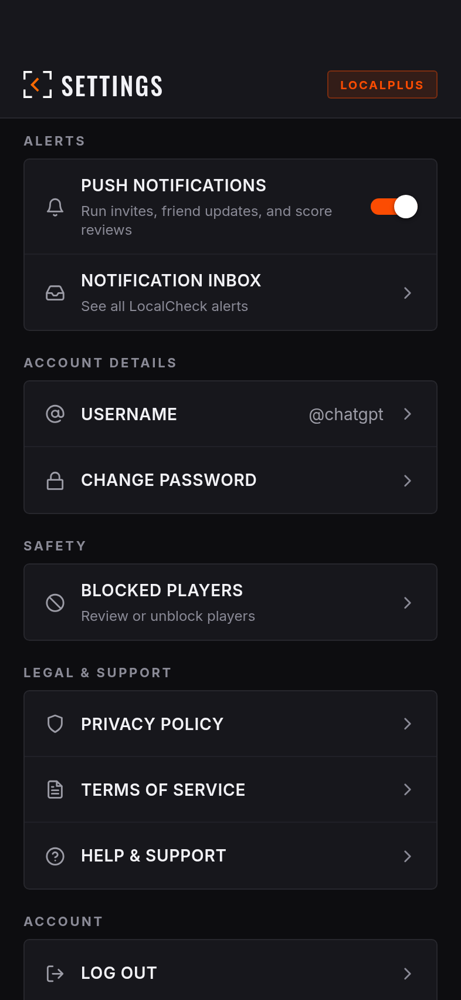](after/settings-alerts-393-normal.png) |
| account, 393pt, normal | [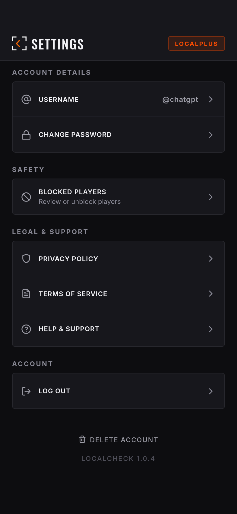](before/settings-account-393-normal.png) | [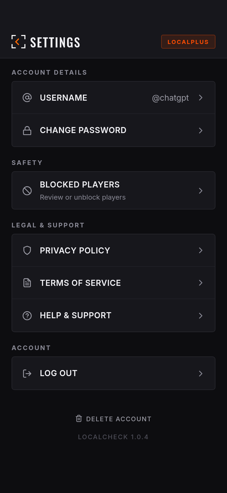](after/settings-account-393-normal.png) |
| preferences, 320pt, long | [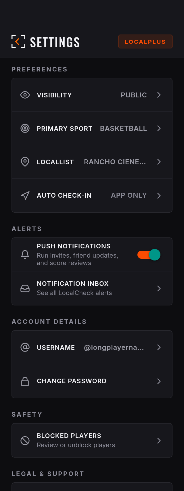](before/settings-preferences-320-long.png) | [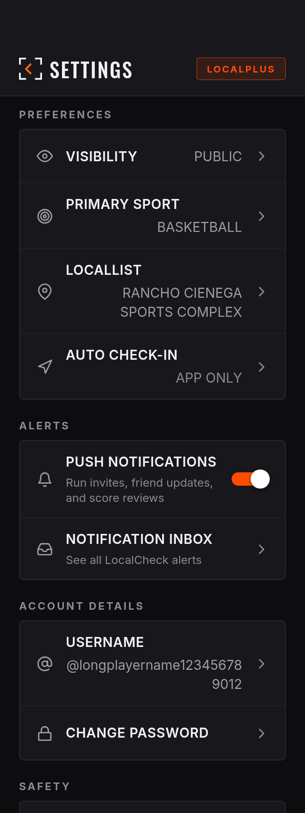](after/settings-preferences-320-long.png) |
| push-off, 375pt, normal | [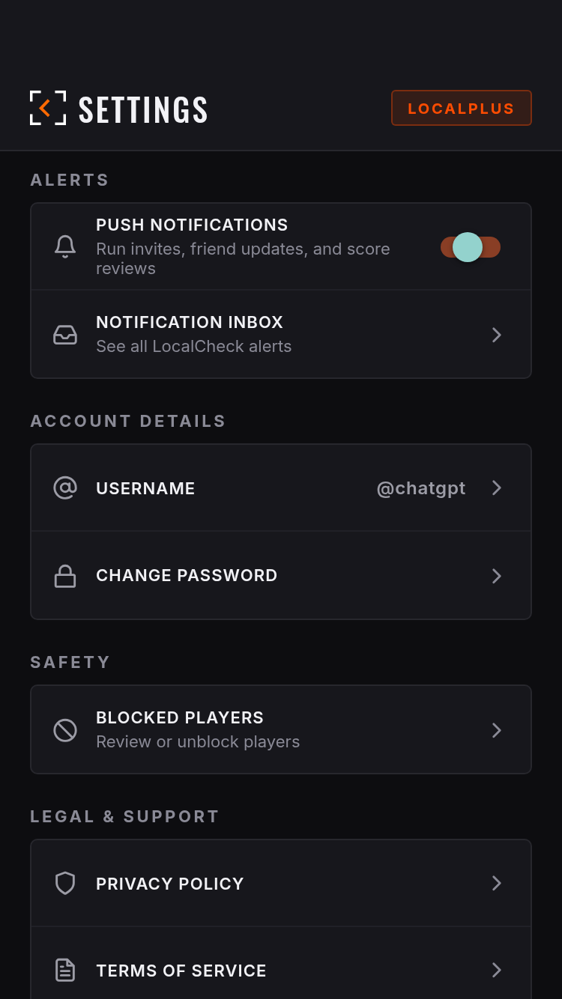](before/settings-push-off-375-normal.png) | [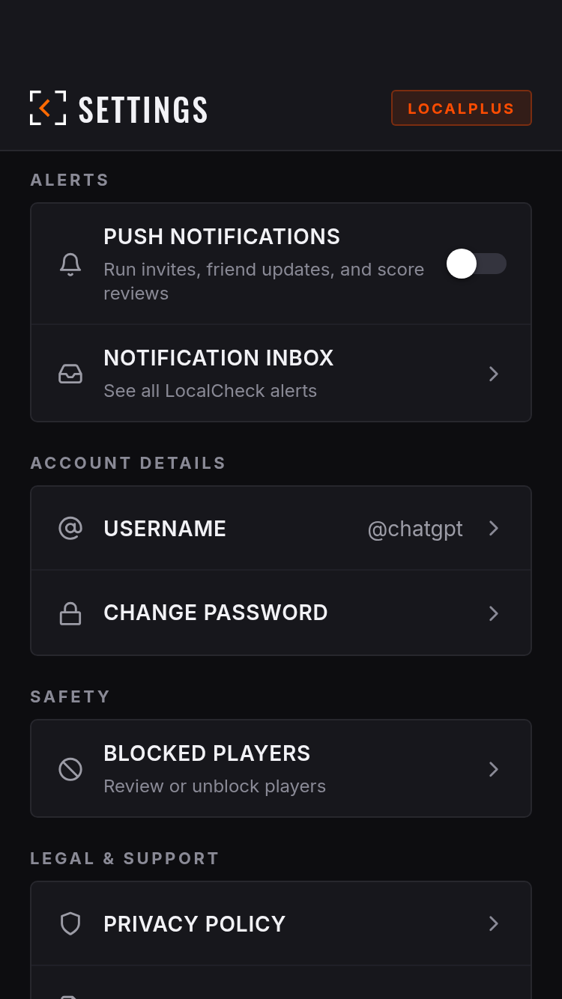](after/settings-push-off-375-normal.png) |

The complete `before/` and `after/` directories each contain 23 captures: all main-page row types at 320/375/393/430pt, long court/account values at 320/393, plus push OFF at 375. The long account fixture deliberately exceeds the signup limit as a stress check; it is not a changed product limit.

## Verification receipt

- 23 strict actual-route captures pass. Every shared row: trailing accessory inset 16pt within 1pt; vertical center error at most 0.5pt; labels 14pt; descriptions 12pt; no measured text overflow. See [measurements](after/measurements.json).
- Browser interaction: enabled push preference toggled OFF, exactly one mocked preference RPC, OFF capture, then Notification Inbox navigation. All service traffic is isolated; no production writes. This does not test OS permission, registration, push delivery or real persistence.
- Scoped Settings audit at 375x667, 393x852 and 430x932: zero clipping/overlap/off-screen failures and zero increases over baseline. Existing audit debt: three small-text instances across sizes and two small-target instances across sizes; see [report](audit/report.md) and [results](audit/results.json). These are not claimed resolved by this pass.
- `pnpm check`, TypeScript, `node --check scripts/visual-qa/settings-rows-journey.mjs`, and `git diff --check` pass.
- Reviewed actual top, Preferences, Alerts and lower-page images, including narrow long-value rows and white switch thumb. No screen-wide or court-hero changes in this step.

Reproduce: start `pnpm preview:web`; run `EXPECT_SETTINGS=1 node scripts/visual-qa/settings-rows-journey.mjs http://127.0.0.1:PORT OUTPUT`; run `CHROMIUM_PATH=/usr/bin/chromium QA_ONLY=settings QA_SIZES=375x667,393x852,430x932 pnpm qa:visual EXPORT_PATH --out OUTPUT` against that same export.

## Resume here

Read `docs/CURRENT_STATE.md`, `docs/FEEDBACK_TRACKER.md`, then this receipt and the PR's latest screenshot comment. Native iPhone switch dimensions, Dynamic Type, safe areas and Expo Go acceptance remain unverified. Do not treat browser geometry as native proof. No merge, production OTA or native build is authorized.

Next bounded UI checkpoint: LocalList management drawer, after main-page review. Persistence of saved courts/default and per-court auto check-in remain separate functional work. Update the PR, chat and authority docs at each verified checkpoint, preserving these historical screenshots.
