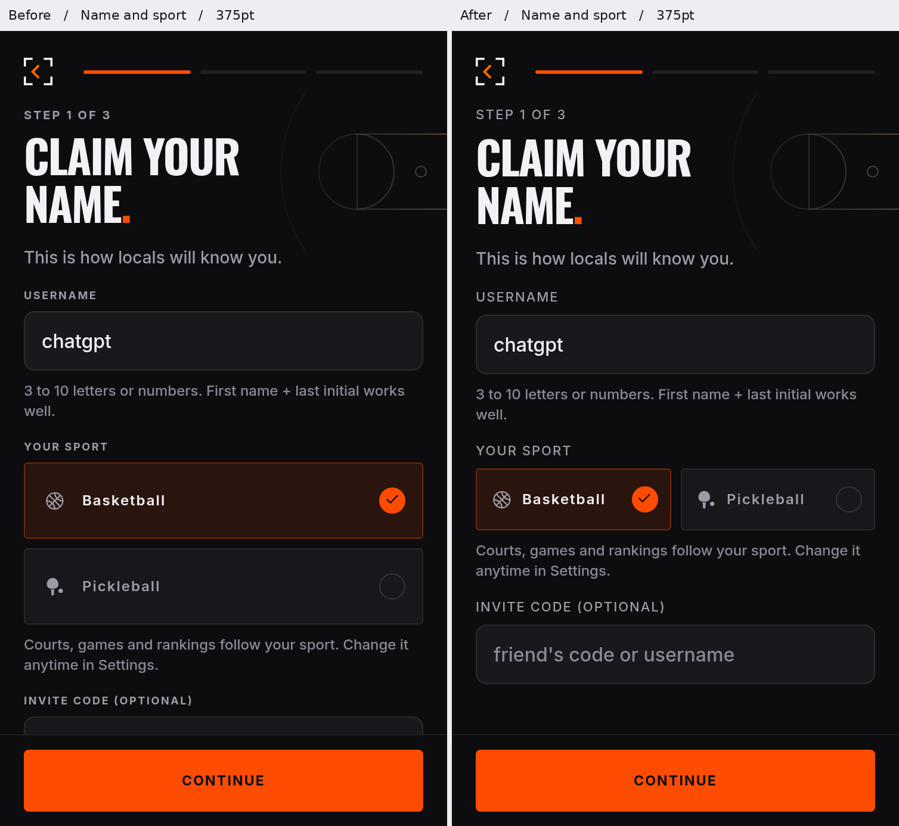

# PR 93 UI comparisons

Each pair shows the same route, data, viewport and font settings before and after the change. Before is PR head `803bbd9`. Both sides are actual Expo web renders captured in Chromium at 2× with isolated Supabase fixtures and a fixed clock.

At 393pt, the Friends and Inbox search frames both start at (20, 323) and measure 353 × 46pt. The two onboarding sport choices each measure 172.5 × 52pt with an 8pt gap. Four players on Home each get 82.25pt, with equal 8pt gaps. The full court name “Rancho Cienega Sports Complex” is visible in the profile and activity entries. Settings rows use 12pt labels and 11pt supporting text.

| Screen | 375 × 667 | 393 × 852 | 430 × 932 |
| --- | --- | --- | --- |
| Welcome | [Compare](375/welcome.webp) | [Compare](393/welcome.webp) | [Compare](430/welcome.webp) |
| Name and sport | [Compare](375/name.webp) | [Compare](393/name.webp) | [Compare](430/name.webp) |
| Court selection | [Compare](375/court-picker.webp) | [Compare](393/court-picker.webp) | [Compare](430/court-picker.webp) |
| Auto check-in setup | [Compare](375/hands-free.webp) | [Compare](393/hands-free.webp) | [Compare](430/hands-free.webp) |
| Alert setup | [Compare](375/alerts.webp) | [Compare](393/alerts.webp) | [Compare](430/alerts.webp) |
| Sign in | [Compare](375/auth.webp) | [Compare](393/auth.webp) | [Compare](430/auth.webp) |
| Home roster | [Compare](375/home.webp) | [Compare](393/home.webp) | [Compare](430/home.webp) |
| Expanded court drawer | [Compare](375/drawer.webp) | [Compare](393/drawer.webp) | [Compare](430/drawer.webp) |
| Explore | [Compare](375/explore.webp) | [Compare](393/explore.webp) | [Compare](430/explore.webp) |
| Friends | [Compare](375/friends.webp) | [Compare](393/friends.webp) | [Compare](430/friends.webp) |
| Inbox | [Compare](375/inbox.webp) | [Compare](393/inbox.webp) | [Compare](430/inbox.webp) |
| Long court name | [Compare](375/activity.webp) | [Compare](393/activity.webp) | [Compare](430/activity.webp) |
| Player activity | [Compare](375/player-activity.webp) | [Compare](393/player-activity.webp) | [Compare](430/player-activity.webp) |
| Settings | [Compare](375/settings.webp) | [Compare](393/settings.webp) | [Compare](430/settings.webp) |
| LocalList | [Compare](375/locallist.webp) | [Compare](393/locallist.webp) | [Compare](430/locallist.webp) |
| Two saved courts | [Compare](375/locallist-two.webp) | [Compare](393/locallist-two.webp) | [Compare](430/locallist-two.webp) |
| Auto check-in settings | [Compare](375/auto.webp) | [Compare](393/auto.webp) | [Compare](430/auto.webp) |
| Settings footer | [Compare](375/settings-footer.webp) | [Compare](393/settings-footer.webp) | [Compare](430/settings-footer.webp) |

## Verification

All 54 captured states passed the project’s DOM checks for clipping, overlap and horizontal overflow. The separate strict Settings journey passed 16 captures, including a long court value and changing the notification preference. LocalList was tested by adding a second court, making it the default, removing the previous default and selecting the eighth result in a scrollable search. All writes in these journeys used in-memory fixtures.

## Verification boundaries

The onboarding journey selected Basketball, used a simulated location, selected a court, continued through auto check-in and declined alerts. Profile search, drawer expansion, and Settings navigation were exercised. Native text scaling, keyboard behavior, OS permissions, Mapbox tiles and physical-device safe areas remain release checks.

The broader fixture runner captured 16 routes/states at three sizes. It reported zero geometry failures and 11 above-baseline counts for small text or touch targets on Home and Settings. The visual release gate remains open.
